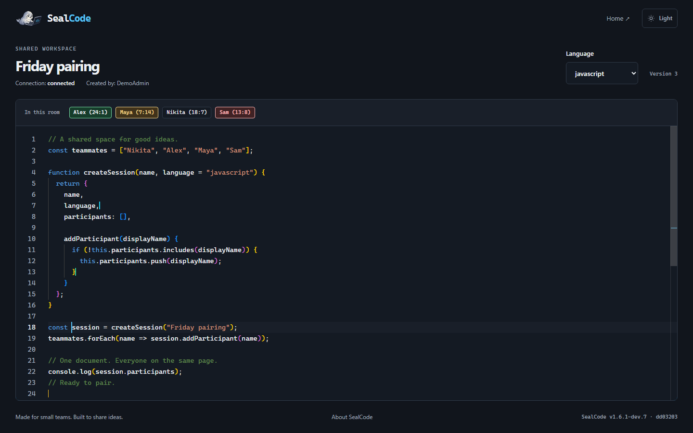
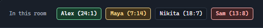

# SealCode

SealCode is a self-hosted collaborative code editor with real-time rooms. The backend is ASP.NET Core Minimal API + SignalR, and the browser UI uses Monaco Editor with Yjs for CRDT syncing. Rooms are in-memory only (no database or persistence).



**Features**
- Real-time multi-user editing with presence and cursors.
- Selective local undo/redo that preserves concurrent edits from other users.
- Room-based sessions with an admin UI to create and close rooms.
- Syntax highlighting with language switching.
- Configurable room capacity.

**Collaboration**

SealCode uses Yjs (CRDT) to merge concurrent edits. Each client produces incremental updates that the server broadcasts to the room.

**Quick Start**
1. Install Node.js 20+ and .NET 10. Configure admin password hashes as described below, then restore and build local browser assets:

```bash
npm ci
dotnet run --project src/SealCode/SealCode.csproj
```

2. Open the app at `http://localhost:5000` (or the URL shown in the console).

**Tests**
- `dotnet test src/SealCode.slnx`
- With Node.js 20 or newer: `npm install`, `npx playwright install chromium`,
  then `npm test` for CRDT unit tests and two-browser collaboration tests.

**Admin Workflow**
1. Visit `/admin/login`.
2. Configure an `AdminUsers` record using `PasswordHash` (see below), then sign in.
3. Create a room and share its link with participants.

**Join a Room**
Open the room link in a browser and enter a display name.

**Configuration**
- `src/SealCode/appsettings.json`
- `AdminUsers`: unique admin names and Identity V3 `PasswordHash` values. Include `IsSuperAdmin` to allow deleting rooms created by other admins. Legacy `Password` is accepted only in Development.
- `Languages`: list of language identifiers supported by Monaco Editor (example: `csharp`, `sql`).
- `MaxUsersPerRoom`: integer from 1 to 5.
- `CollaborativeUndoEnabled`: optional feature flag; defaults to `true`.

The checked-in `appsettings.json` contains empty `PasswordHash` placeholders. Before starting the app, generate a hash for each admin with `dotnet run --project tools/password-hash` and set its `PasswordHash` locally or through environment variables (for example, `AdminUsers__0__PasswordHash`). Paste the generated hash, not the plain-text password. Empty hashes fail configuration validation. Do not commit your credentials.

**Undo and redo**
- `Ctrl+Z` / `Cmd+Z` undoes the current user's latest grouped text operation.
- `Ctrl+Y`, `Ctrl+Shift+Z`, or `Cmd+Shift+Z` redoes it.
- Remote edits are never added to the local undo history.
- Each tab retains up to 100 grouped local operations; reconnect keeps the
  history, while leaving or reloading clears it.

**Synchronization limits**

Checkpoint writers wait 1 second and compact at the server-advertised
`Limits:CheckpointEveryRevisions` (default 64) or
`Limits:CheckpointEveryBase64Bytes` (default 256 KiB of Base64 characters). The latest author writes first; other
participants use 2x thresholds if the author leaves. Defaults remain well below
the 2048-entry / 4 MiB decoded journal budgets. Accepted checkpoints announce
`YjsCheckpointed(checkpointRevision)` to other participants; stale revisions
are rejected before Base64 decoding, with the locked check remaining authoritative.

- SignalR accepts messages up to 16 MiB. The client checks the complete UTF-8
  JSON message, including the full CRDT state and text in a checkpoint, before sending.
- A checkpoint over the limit is skipped with a visible warning; incremental
  edits continue syncing. It is reconsidered when the document revision changes.
- An edit over the limit remains local and queued, with a warning to copy the
  text before reloading. Oversized messages are not retried automatically.
- Admin sessions use protected authentication cookies; old name-only cookies
  require signing in again after upgrading.

**Endpoints**
- `/` landing page
- `/about.html` about page with repository link
- `/room/{roomId}` room UI
- `/admin` admin panel
- `/admin/login` admin login
- `/health` health check
- `/version` version and commit of the running build (not cached)
- `/roomHub` SignalR hub

**Version shown in the footer**
- MinVer stamps the application from Git tags during Build/Publish, including
  Visual Studio Publish. No deployment script or Git installation on the server is needed.
- Release tags use `v` followed by SemVer, for example `v1.2.0`. Publish after
  the tag is created on the release commit, from a checkout containing Git history and tags.
- Commits after a release receive a `dev` prerelease version automatically.
  The footer shows the version and short commit; its tooltip contains the full build version.
- Publishing without building uses the version already embedded in the existing binaries.
  A build is required after creating a release tag. The footer cannot determine
  uncommitted source changes; publish committed code for an identifiable release.


**UI Indication**

The user's cursor position is displayed in the following format:

`User1 (14:25)`

Where:

- `User1` — the user  
- `14` — the line number  
- `25` — the column number (character position within the line)

🎨 The interface uses color cues to reflect user actions and interaction states.



| Color  | Meaning | Description |
|--------|----------|-------------|
| 🟢 Green | Typing | User is actively typing in an input or editor field. |
| 🟠 Orange | Multi-selection | Multiple rows/items are selected. |
| 🔴 Red | Copied | Text has been successfully copied to the clipboard. |

**Production setup and migration**

Generate an Identity password hash offline using `dotnet run --project tools/password-hash`.
The console prompts without echo; do not put a password in command arguments,
shell history, source control, or logs. Configure `AdminUsers__0__Name` and
`AdminUsers__0__PasswordHash` through environment variables or a deployment secret
provider, and remove the old `Password` key entirely. Keep hashes private too.
Existing name-only/older tickets require signing in again. Changing a credential
or removing an account invalidates authorization after the configuration takes
effect. Sessions last eight hours without sliding extension.

Run behind HTTPS. For a reverse proxy, set `TrustedProxies` to its exact IP
addresses, forward the original host and scheme, and configure `AllowedHosts`
for the deployment hostname. Unlisted proxies cannot supply trusted forwarded
headers. Production enables HSTS/HTTPS redirection and Secure admin cookies.
The browser WebSocket Origin must match this effective hostname/scheme. Persist
ASP.NET Data Protection keys securely if sessions must survive a redeployment;
room data still disappears. The application supports one process only; it has
no database, multi-instance coordination or durable room storage. Anyone knowing
a room link is a trusted participant under ADR 0003; server-side CRDT semantic
verification (SC-08) remains conditional.

Admin POST/DELETE requests require a token from `/admin/token` in `X-CSRF-TOKEN`
(or `__RequestVerificationToken` for a form). Fetch a fresh token after login.
The provided UI does this automatically. API input failures return ProblemDetails;
Hub resource refusals contain stable `LimitExceeded`/`RateLimited` codes.
Room names deliberately retain the existing trim/20-character-plus-ellipsis
normalization; raw inputs over 1024 characters are rejected. Participant names
are trimmed and limited to 64 characters.

**Resource budgets**

The `Limits` section accepts `MaxEncodedUpdateBytes` and
`MaxEncodedCheckpointBytes` (4 MiB Base64 characters each), `MaxJournalBytes`
(4 MiB decoded), `MaxJournalCount` (2048), `MaxSnapshotCharacters` (1,048,576),
`MaxRooms` (32), `MaxConnections` (160), `NewConnectionsPerSourcePerMinute`
(30, range 1–10000), and `InvocationsPerSecond` (100).
Increase `Limits:NewConnectionsPerSourcePerMinute` for deployments behind shared
NAT/proxies to accommodate reconnect bursts. Configure `TrustedProxies` so the
source address reflects the intended client boundary.
Defaults are implementation choices verified with 500,000-character documents.
Combined limits must fit a worst-case 16 MiB synchronization response; invalid
settings fail startup. The browser pending/delivery budgets are 8 MiB/2048 entries.
A permanent refusal retains visible unsynced text and stops retries: copy it
before reloading. A valid checkpoint frees journal capacity; accepted updates
are never evicted for quota. Resource counters are available from the
`SealCode.Rooms` and `SealCode.Hub` diagnostic meters without document content.

Checkpoint thresholds are validated at startup: `4 * CheckpointEveryRevisions <=
MaxJournalCount` and `3 * CheckpointEveryBase64Bytes <= MaxJournalBytes`. This
reserves headroom beyond the doubled fallback threshold for in-flight updates
and accounts for Base64-to-decoded-byte conversion. The ranges are 1-10000
revisions and 1024-4194304 Base64 characters, respectively.

**Local assets, publishing and verification**

Build/Publish runs `npm run build:client`; run `npm ci` first on a clean checkout.
Generated `wwwroot/assets` is ignored by Git and included in publication.
Monaco/Yjs/SignalR and workers load locally with a single Yjs instance; no CDN
is needed. CSP intentionally permits inline styles for Monaco, but scripts and
workers must come from this origin. `SkipClientBuild=true` is for an already
prepared client build only.

CI is defined in `.github/workflows/verify.yml`. Browser tests use an isolated
temporary content root with disposable settings, never local admin credentials.
For the additional production check, create a development HTTPS certificate
with `dotnet dev-certs https`, then run
`npx playwright test --config playwright.https.config.js`. The browser test client
ignores trust only for that local test certificate. Server coverage is merged
with ReportGenerator by source lines/branches, rather than averaging project
percentages; JS coverage is reported separately. See ADR 0004 for contracts
and `docs/audit-implementation.md` for validation evidence.
