# SealCode

SealCode is a self-hosted collaborative code editor for small, trusted groups, suitable for pair programming, interviews and discussing code together. Code rooms contain a shared text document with live editing and a shared syntax-highlighting language. Whiteboard rooms offer an infinite canvas for collaborative system design diagrams. Both include participant presence.

The backend uses ASP.NET Core Minimal API and SignalR on .NET 10; the browser uses Monaco Editor and Yjs for CRDT synchronization. Rooms live entirely in server memory. This is a personal project intended for private use.

For a description of how the backend and real-time collaboration work, see [Backend architecture](docs/backend.md).

[Quick start](#quick-start) · [Screenshots](#screenshots) · [Whiteboards](#whiteboard-rooms) · [Question library](#private-question-library) · [Autocomplete](#autocomplete) · [Themes and presence](#themes-and-presence) · [Admin MCP](#admin-mcp)

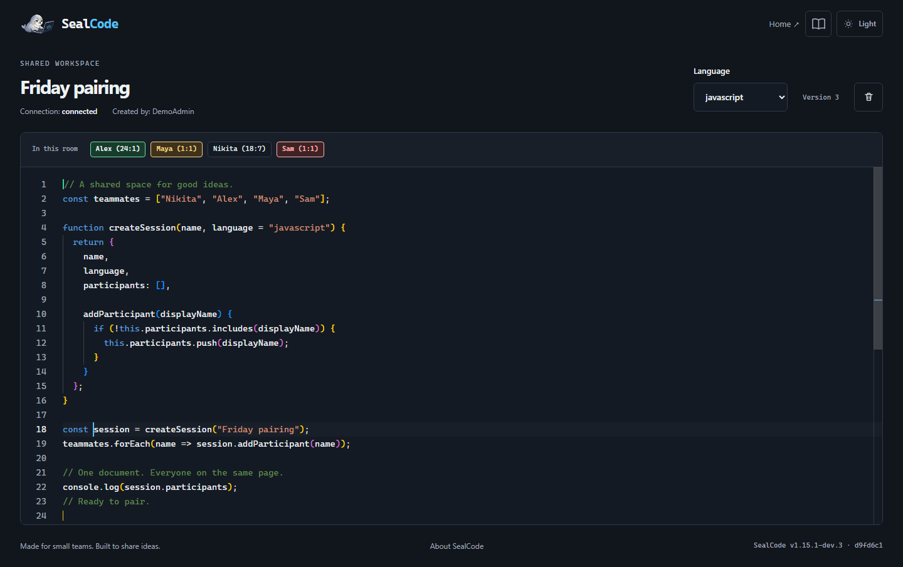

## Features

- Collaborative whiteboard rooms with rectangles, one-way and bidirectional arrows, lines, text, databases, queues, ellipses and diamonds; pan, zoom, labels, resizing and selective undo/redo.
- Real-time multi-user editing in Monaco, with syntax highlighting, participant presence and remote cursors.
- Monaco's built-in autocomplete is always enabled, with language-specific IntelliSense limitations described below.
- Join through an invitation link or paste it on the home page; participants only need a display name, not an account.
- Responsive desktop and mobile layouts with the pixel-art seal identity.
- Dark and light themes across every page and the editor. Dark is the default; the browser remembers the choice and synchronizes it between tabs.
- Selective local undo/redo that preserves concurrent edits from other users.
- Shared language switching by any participant; the checked-in configuration offers C#, SQL and JavaScript.
- Participant list with cursor line/column and typing, selection and copy indicators.
- Automatic reconnection, room rejoin and synchronization recovery, retaining local undo history in the open tab.
- Admin panel to create rooms, copy invitation links, inspect participant counts and delete rooms. Regular admins can delete their own rooms; super admins can delete any room.
- Optional private question library for admins: General, C# and SQL questions, syntax-highlighted code and clipboard copying, in a popup or a separate tab.
- Authenticated MCP tools to list rooms and languages, create rooms with complete invitation URLs, and delete rooms from an MCP client.
- Configurable capacity of 1–5 participants per room, resource budgets and optional expiration of empty rooms.
- Locally bundled editor dependencies and workers. Optional Google sign-in loads Google's identity script.
- Build version and commit in the footer, plus an About page with the project repository link.

## Screenshots

These screenshots show the running application with disposable demo accounts, sample room data and the optional question library enabled.

### Home page and themes

Paste a link to join a room, open room management, or change the theme from the header.
Below the introduction, explore collaborative code, whiteboards, room management
and the optional question library through real product screenshots. Select a
screenshot to enlarge it; Escape closes the preview and returns focus to the link.

| Dark theme (default) | Light theme |
| --- | --- |
| 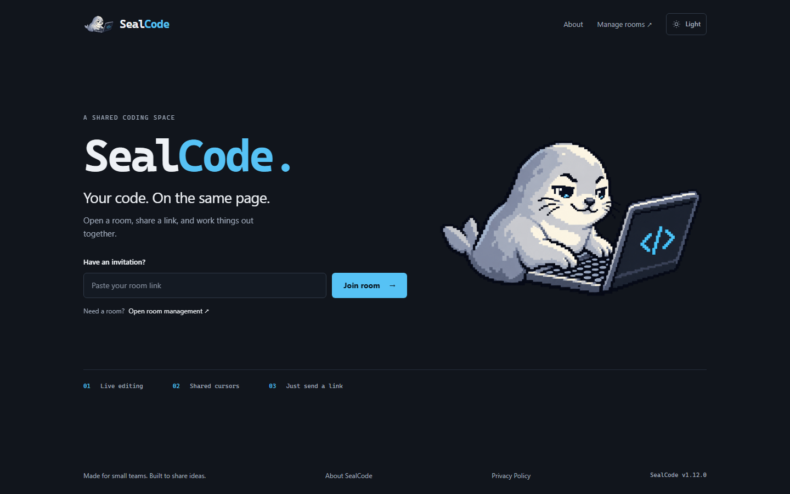 | 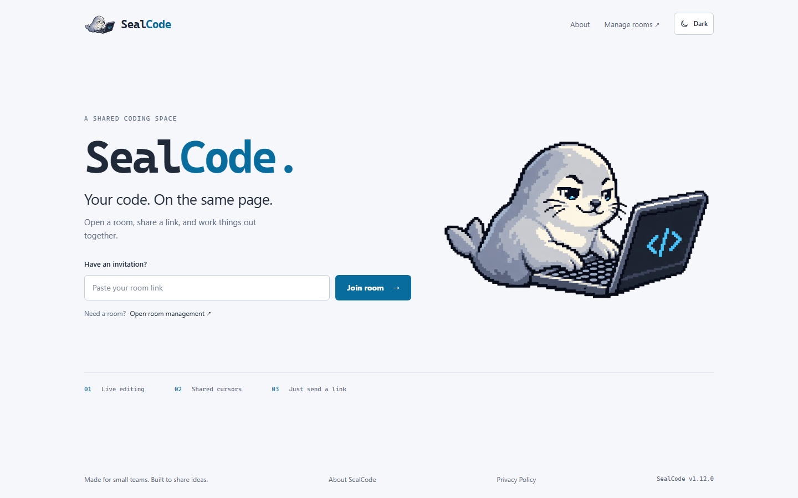 |

### Room management

The admin panel has separate **Create room** and **Create whiteboard** forms.
Code rooms require a language; whiteboards only require a name. Both share the
same room and participant limits. The room list shows the language or Whiteboard
workspace, participant count, owner, update time, invitation link and deletion
action. **Only my rooms** filters the list to the signed-in admin's rooms.

| Admin room management (dark) | Admin room management (light) |
| --- | --- |
| 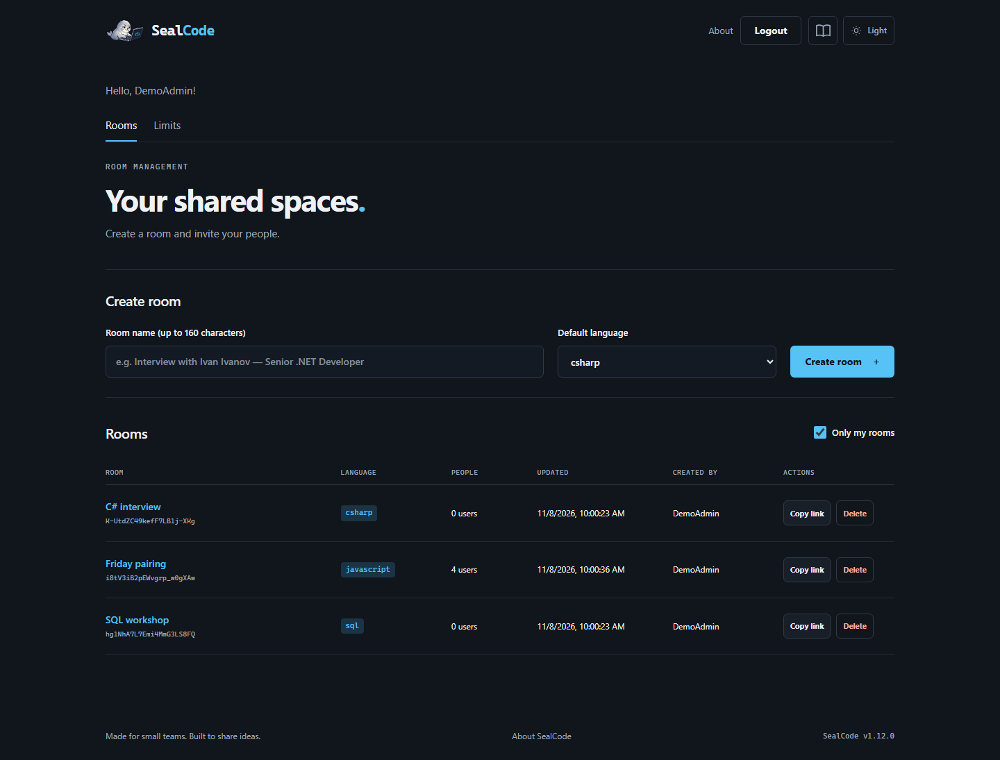 | 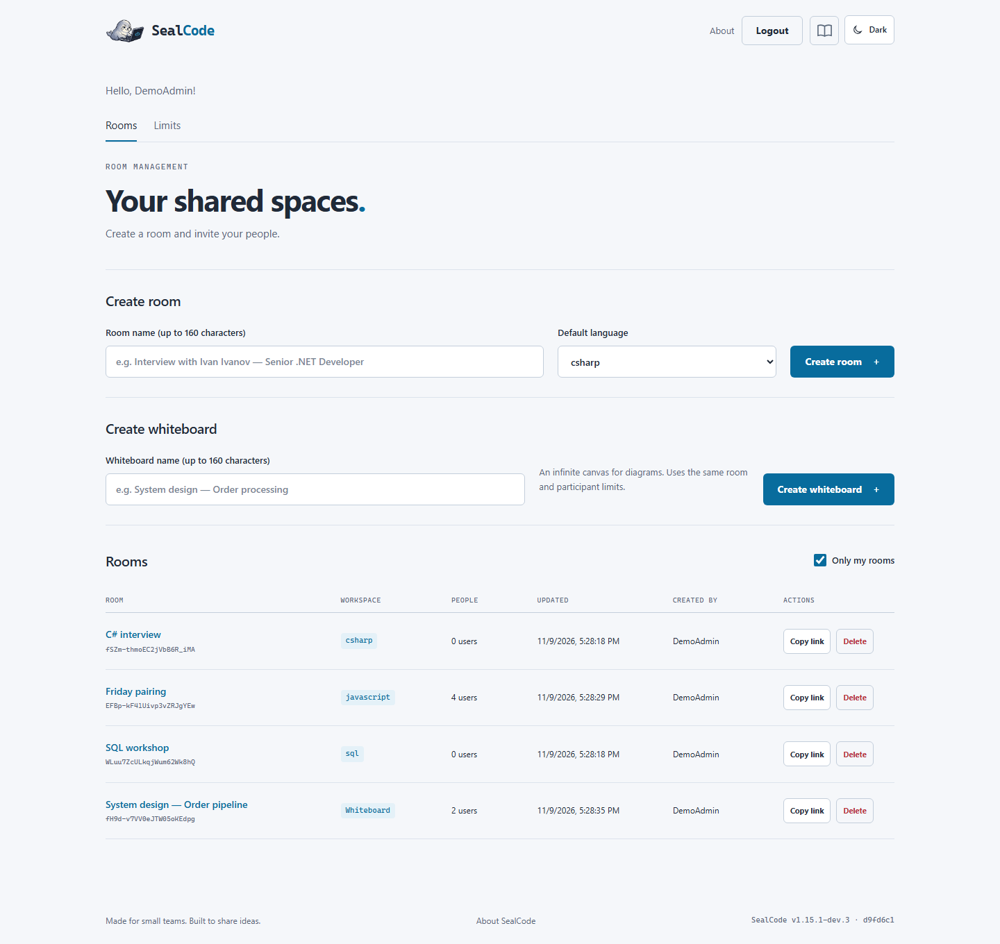 |

### Joining a room

Guests follow an invitation link and choose a display name before entering the
shared workspace. They do not need an admin account.

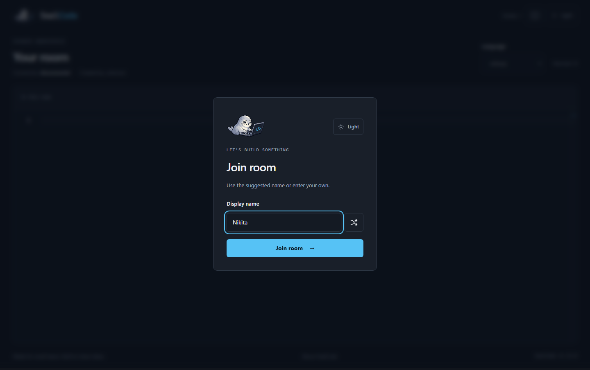

### Code rooms

Monaco fills the workspace below the room name, connection status, shared language
selector and participant bar. Participants can edit together and see remote
cursors and typing, selection and copy indicators.

| Code room (dark) | Code room (light) |
| --- | --- |
| 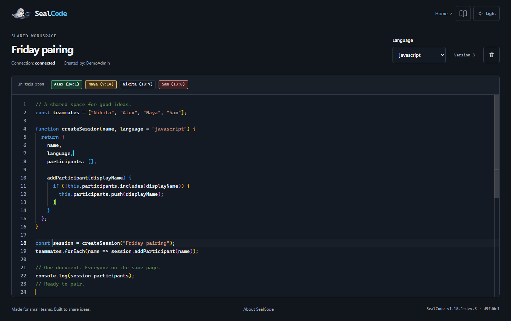 | 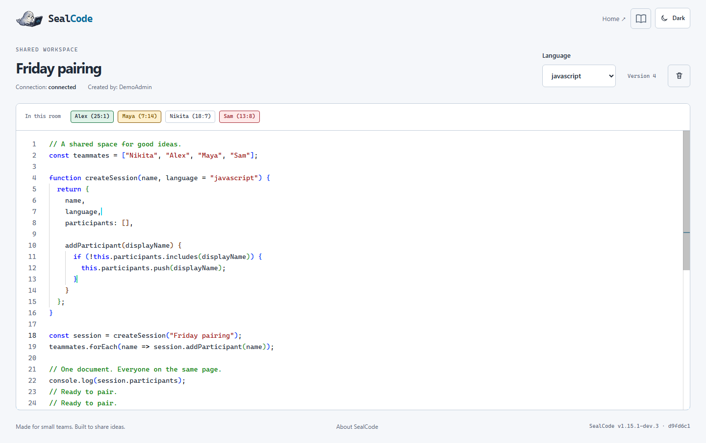 |

### Whiteboard workspace

Whiteboard rooms replace the code editor with an infinite diagram canvas and a
drawing toolbar. The room header, participants and connection status stay
familiar. Labels, one-way and bidirectional arrows, database and queue symbols
cover the essentials for system design interviews; the bottom controls provide undo/redo, deletion, zoom,
Fit and a local JSON download. See [Whiteboard rooms](#whiteboard-rooms) for
shortcuts, collaboration behavior and current limitations.

| Whiteboard (dark) | Whiteboard (light) |
| --- | --- |
| 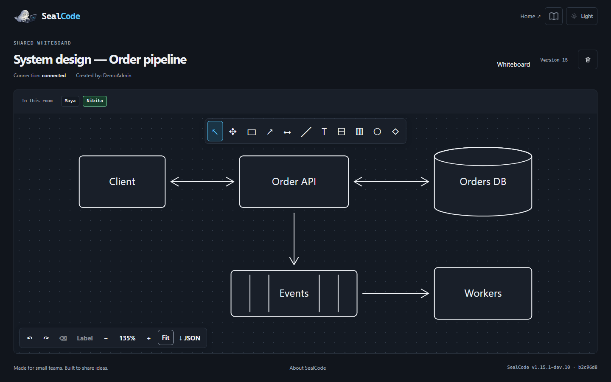 | 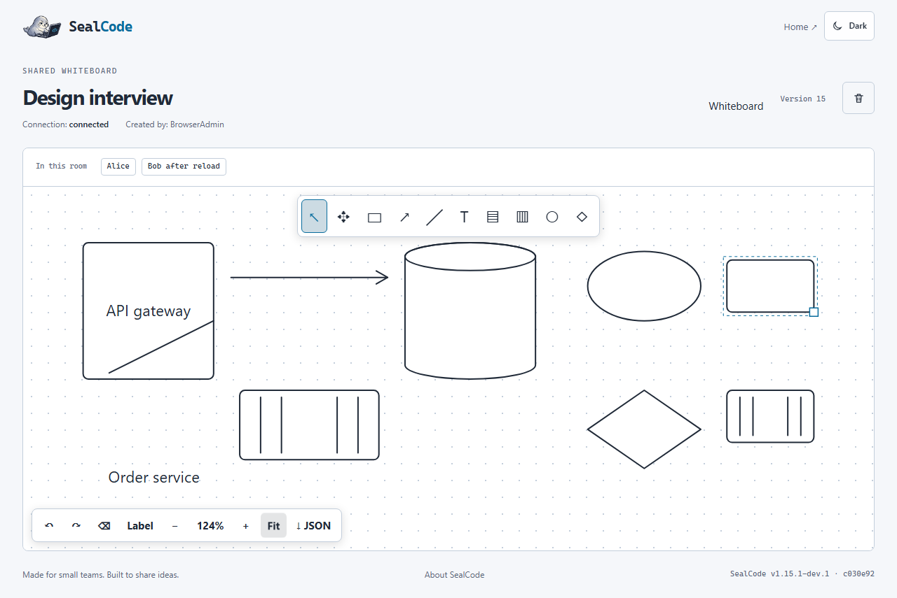 |

Live cursors show each participant's name and color while discussing the diagram.
These screenshots show Maya and Leo pointing at different parts of the same board.

| Participant cursors (dark) | Participant cursors (light) |
| --- | --- |
| 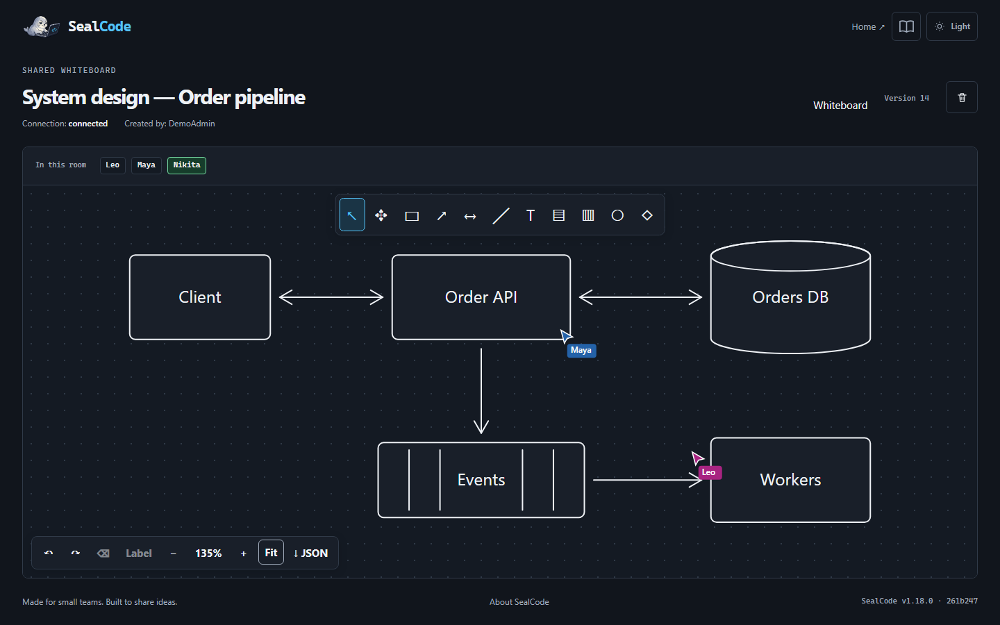 | 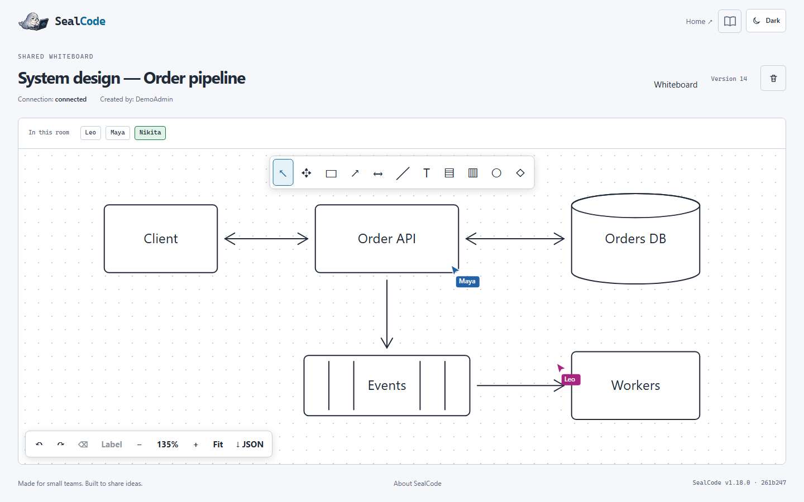 |

<details>
<summary>Mobile home and room management</summary>

| Home | Room management |
| --- | --- |
| 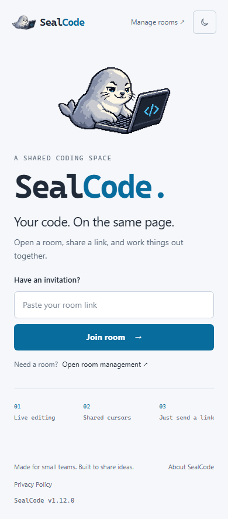 | 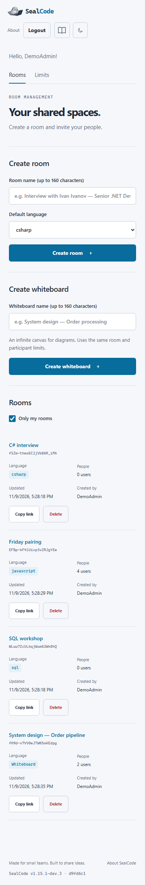 |

</details>

<details>
<summary>Mobile code and whiteboard rooms</summary>

| Code room | Whiteboard |
| --- | --- |
| 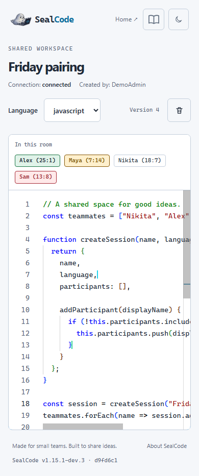 | 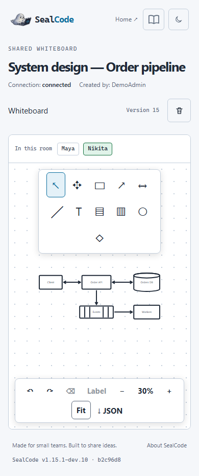 |

</details>

<details>
<summary>Admin sign-in</summary>

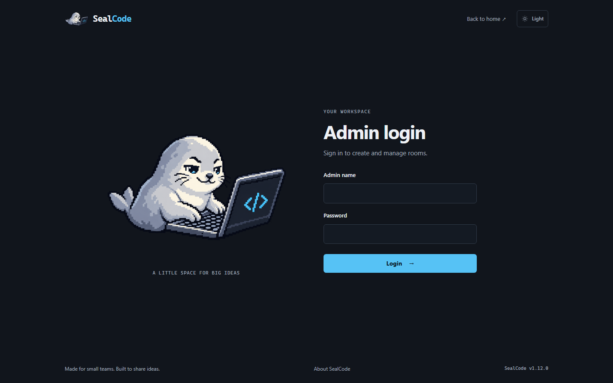

</details>

## Whiteboard rooms

In the admin panel, use **Create whiteboard** with a name. **Create room** continues
creating code rooms with a language. Both appear in the same list and use the same
invitation links, ownership/deletion rules, `MaxRooms`, `MaxUsersPerRoom`, idle
expiration and transport resource budgets. The room kind is fixed at creation.

Other participants' cursors appear with their names and stable colors. They stay
aligned with the diagram when you pan or zoom and disappear when the participant
leaves the canvas or disconnects. Cursor positions are transient: they are not
saved in the diagram, exported, or included in undo/redo.

Choose a tool, then drag on the canvas (or click to insert a default-size element).
Use Select to move an element and its corner handle to resize it. Double-click an
element or choose **Label** to edit its text; Enter saves, Ctrl/Cmd+Enter or
Shift+Enter inserts a line break at the caret, and Escape cancels. Text is plain
text, including labels on shapes.

Labels wrap automatically at word boundaries, splitting long unbroken words as
needed. Explicit line breaks and blank lines are preserved. Resizing a figure
reflows its label; editing text preserves the figure's width and height. The
font shrinks when necessary to fit the height, down to 8px. If the box is still
too small, visual overflow is clipped; the complete text remains stored and
editable, and expanding the box reveals it.

In Select mode, drag on empty canvas to select all figures fully inside the
selection rectangle. Ctrl/Cmd-click a figure to add or remove it from the
selection; Ctrl/Cmd-drag on empty canvas adds enclosed figures. Drag any selected
figure to move the entire selection, preserving its relative geometry. A group
move is one undoable operation and is shared with other participants when the
drag ends. Escape cancels a drag. Keyboard shortcuts use physical letter keys,
including with non-Latin layouts; text fields retain native editing shortcuts.

- Tools: **V** select, **H** pan, **R** rectangle, **A** arrow, **B** bidirectional arrow, **L** line,
  **T** text, **D** database, **Q** queue, **O** ellipse, **M** diamond.
- Pan with Space+drag, middle-button drag, the Pan tool or wheel/trackpad scrolling.
  Zoom with Ctrl/Cmd+wheel or the zoom buttons; **Fit** frames the diagram.
- Delete/Backspace removes the selection; Ctrl/Cmd+D duplicates it.
  Ctrl/Cmd+A selects all current elements. Ctrl/Cmd+C copies the selection;
  Delete/Backspace removes it as one undoable operation. Selection is local;
  elements added by other participants after Select all remain unselected.
  Ctrl/Cmd+V pastes new copies with a
  small offset, including its label and geometry. Repeated pastes use increasing
  offsets. The clipboard also works between whiteboards; label editing keeps
  the usual text copy/paste behavior.
  Pasting ordinary clipboard text creates a text element in the center of the
  current viewport, preserving line breaks and rendering HTML as literal text.
  Up to 4,000 characters are supported per text element. Repeated pastes receive
  a small offset. Text insertion is shared and undone/redone as one operation.
  Ctrl/Cmd+Z and Ctrl/Cmd+Shift+Z (or Ctrl/Cmd+Y) undo/redo your own changes.
- **Download board** exports the current local diagram as JSON, including changes
  that could not be sent. Import is not currently supported.

The board uses local SVG rendering and the existing Yjs journal/checkpoint and
reconnect protocol. Separate elements merge independently; concurrent changes to
one element resolve through Yjs's map conflict rules. A completed drawing, move,
resize or label edit is shared when the gesture is committed. Viewport, tool and
selection remain local. Rooms are in memory and disappear on server restart.
The MVP has no connector attachment/routing, freehand drawing or image uploads.

Whiteboard interaction regression tests cover group movement, marquee and
Ctrl/Cmd-click selection, physical shortcuts with Cyrillic key values, wrapped
labels and resizing, Ctrl/Cmd+Enter, ordinary text paste, native label editing,
multi-participant synchronization, undo/redo and reconnection. Run
`npm run test:client` and
`npx playwright test tests/e2e/whiteboard.spec.js tests/e2e/whiteboard-collaboration.spec.js tests/e2e/whiteboard-snippets.spec.js`.

## Private question library

The **Whiteboard** category includes a Client → API ↔ Database example with an
SVG preview. Choose **Copy snippet**, focus the whiteboard canvas and press
Ctrl/Cmd+V. The complete diagram is inserted with new IDs as a single undoable
operation. Opening the library from a whiteboard selects this category.

Author diagrams in a fenced `whiteboard` block containing JSON with
`format: "sealcode-whiteboard"`, `version: 1` and a `shapes` array, using the same
shape fields as a downloaded board. Labels render as plain text. Clipboard
diagrams support up to 100 shapes and 100,000 characters; every shape is validated
before insertion. The file example is `Resources/Snippets/whiteboard-01.md`.
For PostgreSQL, apply the optional, repeatable
`src/Persistence/Snippets/Migrations/003_whiteboard_example.sql` after migrations
001 and 002. It adds the same example while preserving existing entries.

The optional library ships with three English questions each for General (architecture
and computer science), C# and SQL. An authorized admin sees a book icon in the
admin header and in a room header. Click it for a popup, choose **Open in new tab**
inside the popup, or Ctrl/Cmd-click the book to open a separate tab directly.
Opening the library from a room selects its current language, falling back to
General when that language has no snippets. This applies to both popups and new tabs.
Language buttons run across the top; numbered topics and short coverage descriptions
appear on the left and above the question content. Search the selected language by
number, topic or description; matching is case-insensitive and accepts multiple words.
**Copy snippet** copies the code blocks, or the full question for a General entry.
A question can contain an ordered progression: an original example followed by
one or more **What if?** variations. Wide layouts show two examples side by side;
narrow layouts stack them in reading order. Each example has its own **Copy example**
button; **Copy all snippets** copies the whole progression in order. The C# cancellation
and SQL ranking questions each demonstrate two related examples under one topic.
The library is private to the administrator: opening or copying a question does not
change the shared room document or reveal the library to participants.

Enable it in `src/SealCode/appsettings.json`:

```json
"Snippets": {
  "Enabled": true,
  "SuperAdminsOnly": true,
  "Provider": "File"
}
```

| Setting | Default | Behavior |
| --- | --- | --- |
| `Snippets:Enabled` | `false` | Load the catalog into memory at startup. Disabled libraries perform no file or database reads. |
| `Snippets:SuperAdminsOnly` | `true` | Only super admins can open the page or read its API. Set to `false` for all authenticated admins, including permitted Google admins. |
| `Snippets:Provider` | `File` | `File` loads JSON/Markdown once; `PostgreSql` loads the database at startup and checks its timestamp every 30 minutes. Values are case-insensitive. |
| `ConnectionStrings:Snippets` | unset | Required to load PostgreSQL content. Supply through deployment secrets or `ConnectionStrings__Snippets`. |
| `Snippets:StartupRetryCount` | `3` | Additional startup attempts after likely PostgreSQL connection failures; range 0–10. `0` makes one attempt. File reads are never retried. |
| `Snippets:StartupRetryDelaySeconds` | `2` | Delay between PostgreSQL startup retries; range 0–60 seconds. Each read also uses the connection string's timeout settings. |

The `Snippets` section is optional; omitting it keeps the library disabled.
Environment overrides include `Snippets__Enabled`, `Snippets__SuperAdminsOnly` and
`Snippets__Provider`. Restart after changing settings or local question files.
Database changes appear on the next 30-minute check. Existing sessions are checked on
every library request. Guests cannot read the library, even with a room link.

If the initial file or database read fails, the portal still starts. Authorized
admins see a **red, disabled question-library button** instead of an active link;
guests and admins without library permission still see no control. Direct library
requests return HTTP 503 while no complete catalog is available. There is no
successful synchronization timestamp to display yet.

| File catalog read failure (dark theme) | PostgreSQL unavailable (light theme) |
| --- | --- |
| 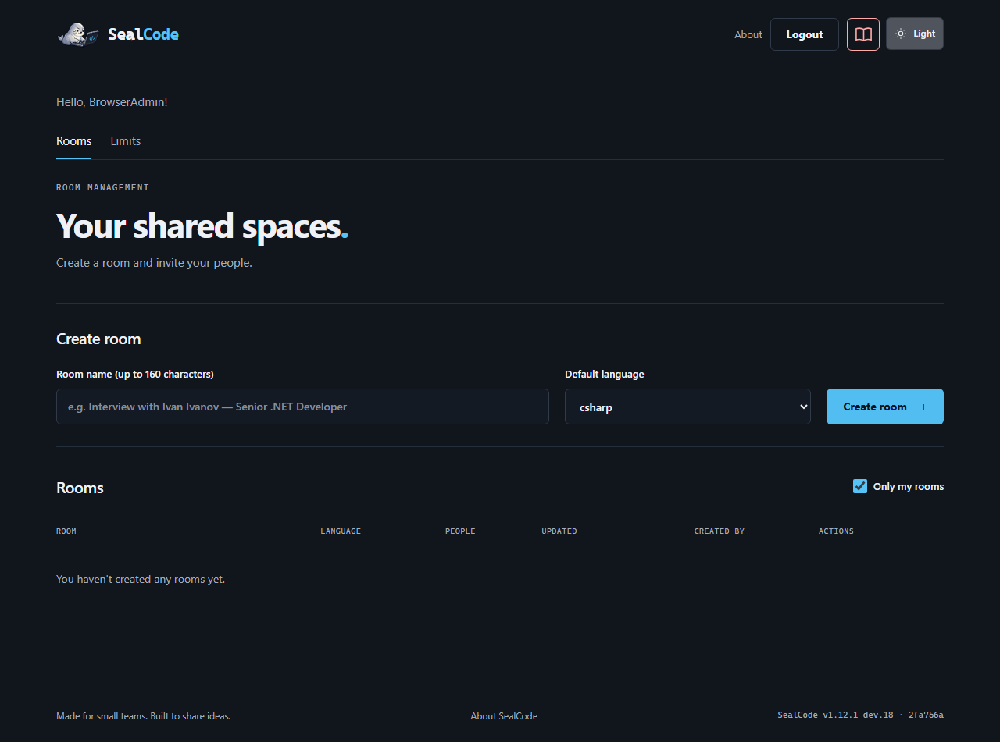 | 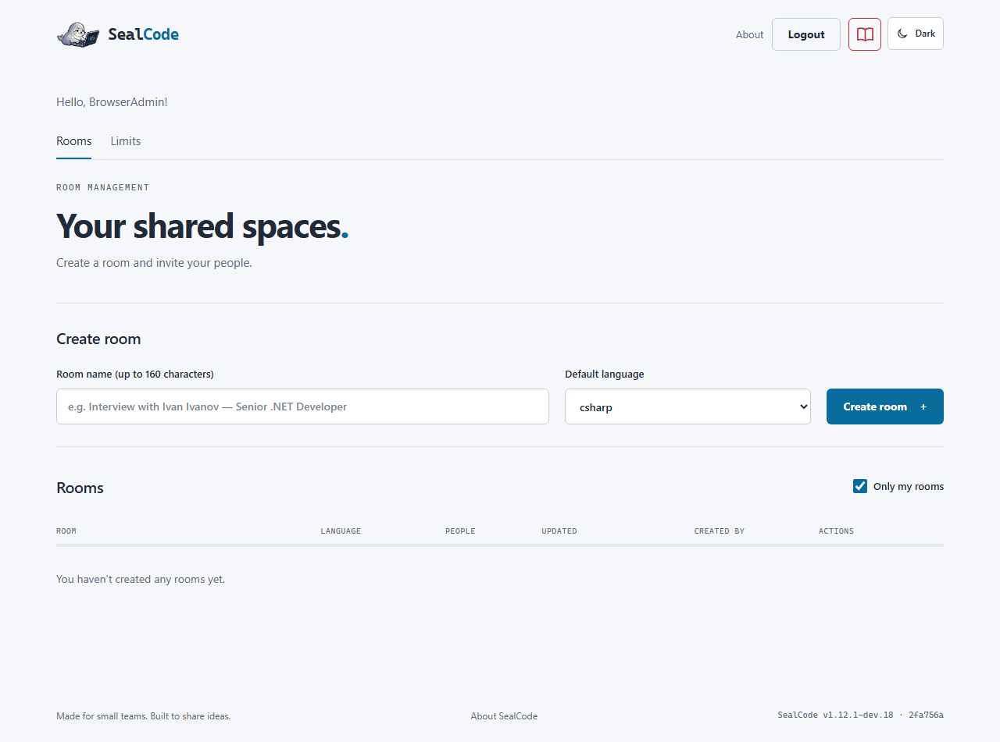 |

PostgreSQL startup retries apply only to likely temporary connection failures:
network/connection timeouts, connection-related server errors, server restart or
too many connections. Invalid credentials, missing schema, invalid content and
invalid connection settings are not retried. For example, set
`Snippets__StartupRetryCount=3` and `Snippets__StartupRetryDelaySeconds=2` for up to
four attempts. After failed startup reads, the regular 30-minute database checks
can recover the library without restarting; reload the portal page to update the
button after recovery. Failed file loads require fixing the files and restarting.

The library heading shows **Last synced**, with the date, time (including seconds)
and time zone in the viewer's local settings. For files, this is when the portal
finished its initial catalog load. For PostgreSQL, it is when the portal finished
its last successful database check, even when the database timestamp was unchanged.
It is the portal's synchronization time, not the content-edit timestamp in the database.
Failed or canceled checks retain the previous time. Reopen or reload the library
to see the latest synchronization time; opening it does not trigger a database query.

The private `src/SealCode/Resources/Snippets/` folder is outside `wwwroot` and is copied
alongside the application during build and publish. The implementation follows the solution layers:
`Models/Snippets` owns immutable domain invariants, `Abstractions` defines
`ISnippetRepository` and `ISnippetCatalog`, `Logic/SnippetCatalog` applies access
and language policy, and `Transport/Models` maps browser responses.
`Persistence/Snippets/FileSnippetRepository` reads JSON and Markdown, while
`PostgreSqlSnippetRepository` reads database snapshots using Npgsql.
`SealCode` supplies HTTP endpoints, dependency injection and startup/refresh hosted services.
Both providers use the same domain models and HTTP contract. The resource JSON, Markdown and HTML
files have no static HTTP routes. Only the authenticated `/admin/snippets` page
and `/admin/snippets/catalog` API expose the library to authorized admins; responses
use `Cache-Control: no-store`.

The catalog API returns its successful synchronization time as an ISO 8601
`X-Snippets-Synced-At` response header alongside the existing category array.
The library and time are captured together as one immutable snapshot.
Question responses include ordered `Steps` with `Number`, `Title` and `Markdown`.
The existing question-level `Markdown` field contains the first example for
compatibility with single-example consumers.

For the `File` provider, edit `Resources/Snippets/catalog.json`, using `catalog.schema.json` for
editor validation, and add a UTF-8 `.md` file in the same folder. Each group has a
unique language ID (`general` or a configured Monaco language ID), a title and a
question list with unique positive `number`, `topic`, a required nonblank
`description` explaining the concepts covered, and a local `file` name.
For example:

```json
{
  "number": 4,
  "topic": "Your next topic",
  "description": "The skills and concepts this question covers.",
  "file": "csharp-04.md"
}
```

Existing version-1 catalogs and single `file` questions remain supported. To author
a progression, set the catalog's root `version` to **2** and replace the question's
`file` with `steps`. Each step has a title, its own Markdown file and a consecutive
number starting at 1. The loader sorts by number; do not combine `file` and `steps`
on the same question. Version 2 may still contain ordinary single-file questions.

```json
{
  "number": 1,
  "topic": "Async and cancellation",
  "description": "Cancellation propagation and resource disposal.",
  "steps": [
    { "number": 1, "title": "Without cancellation", "file": "csharp-01.md" },
    { "number": 2, "title": "What if we pass a token?", "file": "csharp-01-cancellation.md" }
  ]
}
```

Use plain question text and fenced code blocks such as ` ```csharp ` or ` ```sql `.
The viewer renders prose as text and code with Monaco highlighting; raw HTML and
Markdown links are not interpreted. General and configured system languages with authored questions appear. Invalid manifests, duplicate numbers, empty questions and missing files
leave the library unavailable when the feature is enabled. Filenames cannot contain directory paths.

### PostgreSQL snippet storage

1. For a new database, apply [001_create_snippets.sql](src/Persistence/Snippets/Migrations/001_create_snippets.sql)
   then [002_question_steps.sql](src/Persistence/Snippets/Migrations/002_question_steps.sql),
   each **once**, using a schema-owner account in your database UI.
   Existing databases created with migration 001 need **only migration 002**;
   it preserves every existing question and its Markdown as example 1.
   Alternatively, with connection details supplied through PostgreSQL's `PGHOST`,
   `PGPORT`, `PGDATABASE`, `PGUSER` and secure password configuration, run:

   ```bash
   psql -v ON_ERROR_STOP=1 -f src/Persistence/Snippets/Migrations/001_create_snippets.sql
   psql -v ON_ERROR_STOP=1 -f src/Persistence/Snippets/Migrations/002_question_steps.sql
   ```

2. Set `Snippets__Enabled=true`, `Snippets__Provider=PostgreSql` and
   `ConnectionStrings__Snippets` through deployment secrets/environment variables.
   A connection has the shape `Host=<host>;Port=5432;Database=<database>;Username=<user>;Password=<secret>;SSL Mode=VerifyFull`.
   Configure TLS to match your provider's certificate setup. Keep real credentials
   out of tracked settings, command arguments and logs.
3. Add or edit content directly through the database UI. The application does not
   apply migrations, import file content, or write to the database. An empty schema
   displays an empty library. PostgreSQL mode does not fall back to files.

| Table | Content |
| --- | --- |
| `snippets.categories` | One row per normalized language (`general`, `csharp`, `sql`, etc.), nonblank `title`, and `sort_order` for display order. |
| `snippets.questions` | `language` references a category; positive `number` is unique within it. `topic` and `description` describe the whole question; `markdown` and `snippet_title` hold example 1. The title defaults to `Original example`. |
| `snippets.question_steps` | Additional examples: `language` + `question_number` identify the parent question; `number` is 2, 3, …; `title` and `markdown` are required. |
| `snippets.catalog_state` | One automatic `updated_at` timestamp for the library. Do not edit or delete this row. |

Database categories may be empty, so they can be created before authoring questions.
Related manual SQL edits should still be committed together. For example:

```sql
BEGIN;
INSERT INTO snippets.categories (language, title, sort_order)
VALUES ('csharp', 'C#', 10);
INSERT INTO snippets.questions (language, number, topic, description, markdown)
VALUES ('csharp', 1, 'Collections', 'Choosing collection types.',
        'Explain when you would use a Dictionary rather than a List.');
INSERT INTO snippets.question_steps (language, question_number, number, title, markdown)
VALUES ('csharp', 1, 2, 'What if several threads update it?',
        'How would the design change if the same dictionary is updated concurrently?');
COMMIT;
```

Questions appear by number; categories appear by `sort_order`, then language.
Example numbers must be consecutive from 1, without gaps or duplicates. Edit a
progression in one transaction so readers never see a half-finished sequence.
Deleting a question cascades to its follow-up examples; deleting a category
cascades to its questions. Triggers on all three content tables advance `updated_at` on
inserts, updates, deletes and truncates, including changes made through the UI;
no manual timestamp update is needed. Keep triggers enabled when importing data.

At startup the complete library is loaded, with bounded connection retries as
configured above; a failed load leaves only the library unavailable. Every
30 minutes the app compares the database timestamp with the published version.
If unchanged, it reads no question content. If changed, it loads and validates
the library in a repeatable-read transaction, then atomically replaces the immutable
catalog snapshot. Requests continue using the previous snapshot during loading.
Database errors, invalid content and canceled refreshes retain the previous snapshot;
background failures are logged and retried at the next check. Read-only library
requests use the in-memory catalog. Editor requests read/write the database.
The next catalog request sees refreshed content; an already open library page
needs to be reopened or reloaded.

A failed scheduled refresh does not stop the application. Users can continue
opening the previous catalog; **Last synced** stays unchanged until a later check
succeeds. Background failures add no error banner to the library.

When enabled with PostgreSQL, super admins can open **Edit snippets** in the admin
navigation (`/admin/snippets/manage`). **Manage categories** creates, renames and
orders language categories, or deletes a category with all its questions and examples.
Category keys use 1–32 letters, digits, underscores or hyphens and start with a letter.
The public library retains General and the configured room languages.

**New question** creates a question in the selected category. Edit its category,
positive number, topic, description and all examples; moving or renumbering never
overwrites an occupied destination. Questions can also be deleted individually.
Add/remove/reorder examples and review the Markdown preview before publishing.
Category and question deletions require explicit confirmation in the UI.
The preview uses the library's same safe prose/fenced-code renderer. Drafts stay
local until publication. A stale catalog revision returns HTTP 409 and preserves
the form's draft; copy it before reloading and reconciling the current version.

| Markdown source editor | Preview before publication (light theme) |
| --- | --- |
| 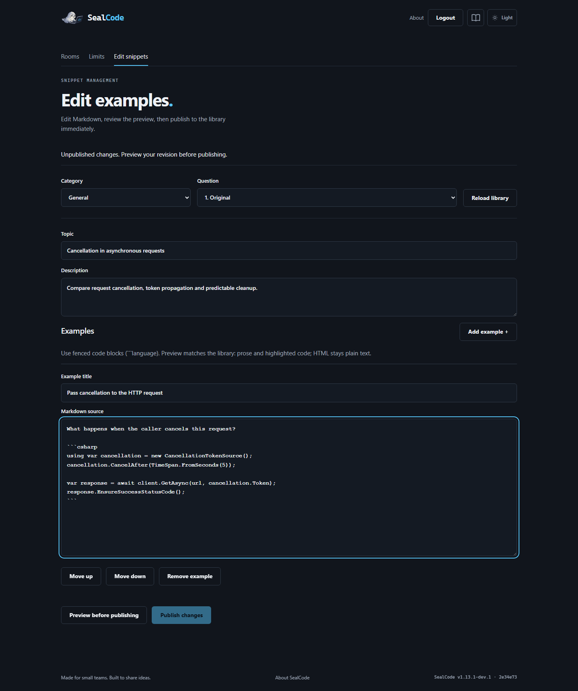 | 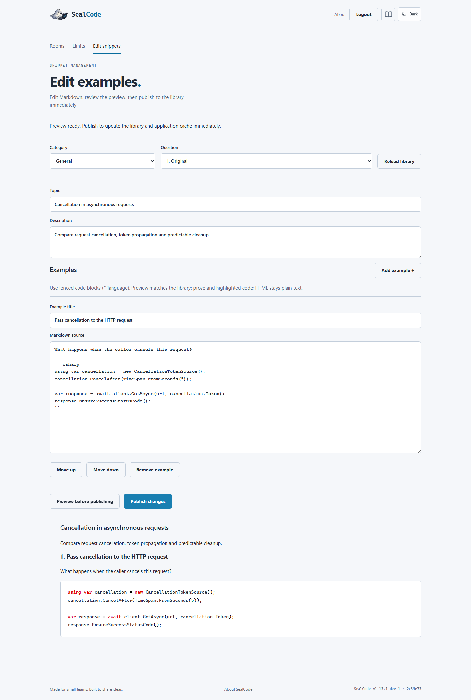 |

The token-protected `/mcp` endpoint exposes the same operations. All snippet tools
require a super-admin token and enabled PostgreSQL snippets:

| Tool | Operation |
| --- | --- |
| `list_snippets` | Read all categories, questions, examples and the current catalog revision. |
| `save_snippet_category` | Create metadata with `originalLanguage: null`, or edit/rename an existing category using its original key. |
| `delete_snippet_category` | Delete a category and its entire question/example tree. |
| `create_snippet_question` | Create a complete question at an unused number in an existing category. |
| `update_snippet` | Edit a question; optional `request.targetLanguage` and `request.targetNumber` move or renumber it. |
| `delete_snippet_question` | Delete a question and all its examples. |

Read `version` from `list_snippets`, then call `update_snippet` with `language`,
`number`, and `request` containing `expectedVersion`, `topic`, `description`, and the
complete ordered `steps` array of `{ title, markdown }` objects (MCP JSON uses camelCase).
Each mutation requires the current revision. UI and MCP commit related changes in one
transaction, reject concurrent edits, and **await an immediate cache refresh**
before reporting success. The 30-minute worker remains for out-of-band SQL edits.
Open library pages need to be reloaded to display a newly published revision.

The runtime account needs `CONNECT` to the database, `USAGE` on schema `snippets`,
and `SELECT` on all four tables. Editing additionally requires `INSERT, UPDATE, DELETE`
on categories, questions and examples, plus `UPDATE` on `snippets.catalog_state`
(the timestamp triggers update that singleton row).
For example, replace `sealcode_runtime` with your deployment role:

```sql
GRANT UPDATE ON snippets.catalog_state TO sealcode_runtime;
GRANT INSERT, UPDATE, DELETE ON snippets.categories, snippets.questions,
    snippets.question_steps TO sealcode_runtime;
```

Migrations still run separately under a schema-owner account. No new migration
is needed after `002_question_steps.sql`. Room state remains in memory.

An optional **read-only** integration test uses a migrated, populated database.
Set `SEALCODE_SNIPPETS_TEST_CONNECTION` securely in the test process environment, then run:

```bash
dotnet test src/Persistence.Tests --filter FullyQualifiedName~PostgreSqlSnippetRepository
```

Without that variable, the database test is explicitly skipped. It never applies
migrations or modifies content.

For migration, mapping, invalid-content and trigger tests, set
`SEALCODE_SNIPPETS_ISOLATED_TEST_CONNECTION` to a **disposable PostgreSQL test server**
with `CREATE DATABASE` permission. These tests create uniquely named databases,
apply the migration, exercise changes, and drop the databases in cleanup. Never
point this separate variable at the production server. CI runs these tests against
its own PostgreSQL service container; no deployment credentials are needed.

The browser editor test also accepts `SEALCODE_SNIPPETS_EDITOR_TEST_CONNECTION`,
pointing to a disposable migrated database containing category `general` and
question `1`. It rewrites that question while verifying preview, conflict handling,
permissions and immediate cache publication. CI provisions this database automatically:

```bash
npx playwright test tests/e2e/snippet-editor.spec.js
```

To refresh the editor screenshots using that same disposable database:

```powershell
$env:CAPTURE_SNIPPET_EDITOR = '1'
npx playwright test tests/e2e/snippet-editor.spec.js
Remove-Item Env:CAPTURE_SNIPPET_EDITOR
```


| Popup from the admin panel | SQL library in a separate tab |
| --- | --- |
| 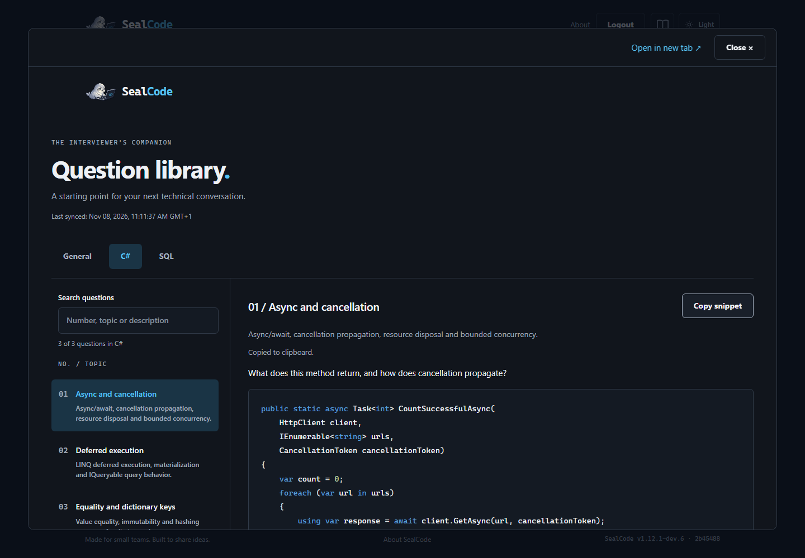 | 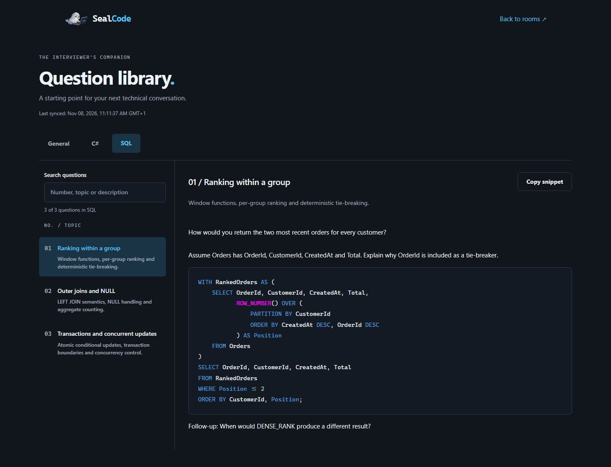 |

To run the library browser tests and refresh all four library screenshots,
including unavailable states, with disposable accounts and isolated hosts:

```powershell
npm run build:client
$env:CAPTURE_SNIPPETS = '1'
npx playwright test tests/e2e/snippets.spec.js
Remove-Item Env:CAPTURE_SNIPPETS
```

## Scope and room lifetime

Participants join through a room link and a display name, without an account or password. Anyone with the link can edit the document and change its language, so share links only with trusted participants.

Each room is a single editing buffer: there is no project/file tree, code execution, terminal, Git integration or durable revision history. Copy out any text you want to keep. Closing a tab leaves the room; an empty room remains available until an admin deletes it, an enabled idle timeout expires, or the server stops. Restarting the application loses all rooms and their contents. Deployment supports a single application process.

## Collaboration

SealCode uses Yjs (CRDT) to merge concurrent edits. Each client produces incremental updates that the server broadcasts to the room. The server retains a checkpoint and an update journal for new participants and reconnecting tabs; clients periodically compact the journal with a new checkpoint. These checkpoints are in-memory synchronization state, not saved files or backups.

During a detected disconnection or room rejoin, the editor becomes read-only. After reconnecting, the client merges the room state and retries queued updates. Permanent size/quota failures display a warning to copy unsynced text before reloading. Deleting a room notifies connected participants and disables editing.

## Quick Start

Run the following from the repository root with Node.js 20+ and the .NET 10 SDK installed.

1. Install browser dependencies:

```bash
npm ci
```

2. Generate an admin password hash:

```bash
dotnet run --project tools/password-hash
```

Set `PasswordHash` for **every** admin in `src/SealCode/appsettings.json`, or remove unused admin records. The checked-in configuration has two accounts with empty hashes, so configuring only one is insufficient. See [Configuration](#configuration) for environment-variable overrides.

3. Prepare the local HTTPS certificate and start the application (the build also bundles browser assets):

```bash
dotnet dev-certs https --trust
dotnet run --project src/SealCode/SealCode.csproj
```

4. The checked-in launch profile uses `https://localhost:61670` and `http://localhost:61671`; use the URL shown in your console if overridden. Open `/admin/login`, sign in with a configured admin account, create a room and share its link.

## Tests

Use Node.js 20 or newer for the client build and test runner (CI uses Node.js 24). After `npm ci`, install Chromium once with `npx playwright install chromium`.
Run `npm run build:client` before browser tests. Browser tests build the server and
start their own isolated application instance. Set `E2E_PORT` to override the HTTP
port (5087) or the production HTTPS check port (5088).

| Command | Coverage |
| --- | --- |
| `npm run test:smoke` | Admin login, room creation, multi-user editing, language switching, late join, selective undo, leaving and room deletion |
| `npm run test:client` | Client synchronization, recovery, undo, presence, lifecycle, invitation validation and theme unit tests |
| `npm run test:e2e` | Browser collaboration, recovery, limits, security and UI tests, including smoke |
| `npx playwright test tests/e2e/appearance.spec.js` | Theme persistence and tab synchronization, blocked storage, first-render theme, desktop/mobile layouts, keyboard joining, slow editor loading, and preserving text/selection/undo when changing theme |
| `npx playwright test tests/e2e/autocomplete.spec.js` | Always-enabled suggestions, C# word completion and IntelliSense limitations, native Enter/Tab completion, concurrent edits in the same prefix in both delivery orders, model/rendered-text convergence, undo/redo and reconnect; records the overlapping-deletion undo limitation described below |
| `npm test` | Client unit tests and the browser suite |
| `npx playwright test tests/e2e/snippets.spec.js` | Private library popup/tab/room, search and descriptions, clipboard, ordinary-admin permissions, guests and logout |
| `npm run typecheck` | Static JavaScript type checking |
| `dotnet test src/SealCode.slnx` | Server domain, service, hub, API and configuration tests |
| `dotnet format src/SealCode.slnx --verify-no-changes --no-restore` | C# formatting and style rules from `src/.editorconfig`; run restore first |

Snippet tests follow the project layers: domain invariants and immutable collections
in `Models.Tests`, initialization/concurrency/cancellation and access policy in
`Logic.Tests`, file-format validation in `Persistence.Tests`, browser DTO mapping
in `Transport.Tests`, and startup/HTTP integration in `SealCode.Tests`.
Run only snippet tests with `dotnet test src/SealCode.slnx --filter FullyQualifiedName~Snippet`.
HTTP integration cases also carry `Category=Integration`. CI runs these projects
through the solution and discovers `snippets.spec.js` in its full browser suite.

## Optional Google organization sign-in

Google sign-in is disabled until both a web client ID and one or more allowed
Google Workspace hosted domains are configured. Existing password accounts
continue to work. Every permitted Google user receives ordinary admin rights:
they may create rooms and delete their own rooms, but cannot delete another
admin's rooms. Google sign-in never issues an MCP token; MCP remains limited
to bearer tokens on configured `AdminUsers` accounts.

1. In your own Google Cloud project, configure the Google Auth Platform branding
   and an **External** audience. Create an OAuth client of type **Web application**.
2. Add the site's exact HTTPS origin, for example `https://portal.example.org`,
   under **Authorized JavaScript origins**. For local testing, add the local
   origin separately, for example `https://localhost:61670`. This button uses
   a JavaScript callback, so no redirect URI or client secret is used.
3. Configure `GoogleSignIn__ClientId` with the web client ID and
   `GoogleSignIn__AllowedHostedDomains__0` with an exact Workspace hosted
   domain, such as `example.org`. Additional domains use index `__1`,
   `__2`, and so on. Restart the application.
4. Publish the External app in Google Auth Platform when it is ready for
   organization-wide use; Testing mode admits only listed test users.

The backend validates the Google-signed ID token, its audience and verified
email, then requires an exact match on the token's `hd` hosted-domain claim.
An email address ending in the allowed domain without that Google Workspace
claim is not sufficient. A Google user's stable `sub` identifies room ownership;
their email is displayed as the owner. Domain changes in configuration take
effect for existing sessions on the next request. Existing signed-in sessions
can otherwise remain valid for up to eight hours after an account is disabled
at Google. A Google Workspace administrator may block third-party sign-in
under organization policy.

## Admin MCP

The same server exposes admin room management at `/mcp` over Streamable HTTP
using the [official MCP C# SDK](https://csharp.sdk.modelcontextprotocol.io/v2/concepts/transports/transports.html).
Configure a separate `McpToken` next to `PasswordHash` in each `AdminUsers` record:

```json
{
  "Name": "admin",
  "PasswordHash": "<existing Identity V3 hash>",
  "McpToken": "<unique random token of at least 32 characters>",
  "IsSuperAdmin": true
}
```

An absent or empty token disables MCP for that account. Tokens must be unique,
case-sensitive, and contain 32–1024 characters from the
[Bearer token alphabet](https://www.rfc-editor.org/rfc/rfc6750#section-2.1):
letters, digits, `-`, `.`, `_`, `~`, `+`, `/`, with optional trailing `=` padding.
Generate one locally with PowerShell:

```powershell
[Convert]::ToHexString([System.Security.Cryptography.RandomNumberGenerator]::GetBytes(32))
```

Set the token locally in `appsettings.json` or through `AdminUsers__0__McpToken`;
keep real tokens out of commits. Restart the server after changing credentials.
Connect an MCP client to `https://<your-host>/mcp` with this HTTP header:

```text
Authorization: Bearer <McpToken>
```

The endpoint requires the bearer token on every request, independently of admin
browser cookies. It does not require CSRF tokens or a browser login and uses no
server-side MCP sessions. Cross-origin browser requests are rejected; configure
`AllowedHosts` for the public host names used by your deployment.

| Tool | Function |
| --- | --- |
| `list_rooms` | All rooms with names, languages, participant counts, owners, update times, deletion permissions and complete invitation URLs |
| `list_languages` | Allowed languages for room creation |
| `create_room` | Create a room with `name` and optional `language` (default `csharp`); return its ID and complete invitation URL |
| `delete_room` | Delete `roomId` and notify connected participants |

Use `invitationUrl` as the ready-to-share room link, for example
`https://seal-code.com/room/<id>`. It uses the MCP request's scheme, host, port
and application path base. `invitationPath` remains available for existing clients.
Behind a reverse proxy, preserve the public `Host` header and configure
`TrustedProxies` so `X-Forwarded-Proto` from that proxy supplies the public scheme.
The server ignores forwarded headers from untrusted sources.
Room names, language validation, capacity limits and deletion permissions are
the same as in the admin panel. The token identifies its configured admin:
regular admins can delete their own rooms and super admins can delete any room.
Invalid inputs, missing rooms and forbidden deletions return MCP tool errors.

## Admin Workflow

1. Open **Manage rooms** on the home page, or visit `/admin/login`.
2. Sign in with an admin account configured before startup.
3. Enter a room name, choose its default language, and select **Create room**.
4. Click a room name to open it in a new tab, or use **Copy link** to share the invitation with participants.

Room names can contain up to 160 characters, enough for a candidate's full name,
position and interview date. Names are saved in full and wrap in the room list
and meeting heading; hovering over either name also shows the full text.

The panel greets you with **Hello, <username or email>!** so you can identify the
signed-in account. By default, **Only my rooms** is selected and the panel lists
rooms created by your current account, including when signed in as a super admin.
Clear **Only my rooms** to see all rooms with language, participant count, last
update time and creator.
**Delete** closes the room and disconnects its participants. Regular
admins can delete only their own rooms; super admins can delete any room. Use
**Logout** to end the admin session. The same room-management operations are also
available through the [MCP endpoint](#admin-mcp).

Open **Limits** in the admin navigation to view the running application's configured
room, participant and connection limits, plus automatic cleanup and join timeouts.
The expandable **Technical limits** section shows synchronization and request budgets.
This page is read-only and available to every signed-in administrator. Values come
from the server; changing configuration requires restarting the application.

## Join a Room

Open an invitation directly, or paste a room link from the same SealCode instance
into the home page and select **Join room**. Invalid links show an inline error.

The join dialog waits for the editor to load before enabling its controls. A random
name such as **Wild Fox**, **Bold Seal** or **Shy Otter** is filled in automatically.
Keep it, use the shuffle button beside the field for another random name, or replace
it with your own. Then select **Join room** or press **Enter**.
The generator uses browser cryptographic randomness and 256 short adjectives ×
256 animal names (65,536 combinations). With five participants, the chance of any
random name collision is about 0.015%; the server still rejects duplicate names.
Names are generated per page load, are not stored, and stay the same during reconnects.
Names are trimmed,
limited to 64 characters and must be unique within the room (case-insensitive).
Joining a full room is rejected.

Inside the room, participants share the document and the **Language** selection.
The header shows the connection state, creator and room version; the participant
bar shows who is present and where they are working. Close the tab or navigate
away to leave. No participant account or installation is required.

## Configuration

- `src/SealCode/appsettings.json`
- `AdminUsers`: unique admin names and Identity V3 `PasswordHash` values. Include `IsSuperAdmin` to allow deleting rooms created by other admins. Legacy `Password` is accepted only in Development.
- `GoogleSignIn`: optional web `ClientId` and exact `AllowedHostedDomains`; both must be set together.
- `Languages`: list of language identifiers supported by Monaco Editor (example: `csharp`, `sql`).
- `MaxUsersPerRoom`: integer from 1 to 5.
- `CollaborativeUndoEnabled`: optional feature flag; defaults to `true`.

The checked-in `appsettings.json` contains empty `PasswordHash` placeholders. Before starting the app, generate a hash for each admin with `dotnet run --project tools/password-hash` and set its `PasswordHash` locally or through environment variables (for example, `AdminUsers__0__PasswordHash`). Paste the generated hash, not the plain-text password. Empty hashes fail configuration validation. Do not commit your credentials.

## Undo and redo

- `Ctrl+Z` / `Cmd+Z` undoes the current user's latest grouped text operation.
- `Ctrl+Y`, `Ctrl+Shift+Z`, or `Cmd+Shift+Z` redoes it.
- Remote edits are never added to the local undo history.
- Each tab retains up to 100 grouped local operations; reconnect keeps the
  history, while leaving or reloading clears it.

## Synchronization limits

The client reads the server's update, checkpoint and text-snapshot limits from
`/features`. It splits queued edits into batches within `MaxEncodedUpdateBytes`;
if a merged batch is refused, it retries each edit separately before blocking.
Checkpoint state and text are checked against `MaxEncodedCheckpointBytes` and
`MaxSnapshotCharacters` before transmission.

Checkpoint writers wait 1 second and compact at the server-advertised
`Limits:CheckpointEveryRevisions` (default 64) or
`Limits:CheckpointEveryBase64Bytes` (default 256 KiB of Base64 characters). The latest author writes first; other
participants use 2x thresholds as a fallback. Defaults remain well below
the 2048-entry / 4 MiB decoded journal budgets. Accepted checkpoints announce
`YjsCheckpointed(checkpointRevision)` to other participants; stale revisions
are rejected before Base64 decoding, with the locked check remaining authoritative.

- SignalR accepts messages up to 16 MiB. The client checks the complete UTF-8
  JSON message, including the full CRDT state and text in a checkpoint, before sending.
- A checkpoint over the limit is skipped with a visible warning; incremental
  edits continue syncing. After a size refusal, it is reconsidered only after
  another `CheckpointEveryRevisions` revisions.
- An edit over the limit remains local and queued, with a warning to copy the
  text before reloading. Oversized messages are not retried automatically.
- Admin sessions use protected authentication cookies; old name-only cookies
  require signing in again after upgrading.

## Endpoints

- `/` landing page
- `/about.html` about page with repository link
- `/room/{roomId}` room UI
- `/admin` admin panel
- `/admin/limits` configured application limits (admin page)
- `/admin/limits/config` current room, participant and resource limits (GET, admin only)
- `/admin/login` admin login
- `/admin/logout` admin logout (POST)
- `/admin/me` current admin display name (GET, admin only)
- `/admin/rooms` list/create rooms (GET/POST, admin only); GET accepts `?mine=true` to list only the current admin's rooms
- `/admin/rooms/{roomId}` delete a room (DELETE, owner or super admin)
- `/admin/token` antiforgery token for admin requests
- `/mcp` authenticated admin tools over Streamable HTTP
- `/languages` configured language identifiers
- `/features` collaborative undo flag and synchronization/resource limits
- `/health` health check
- `/version` version and commit of the running build (not cached)
- `/roomHub` SignalR hub

## Version shown in the footer

- MinVer stamps the application from Git tags during Build/Publish, including
  Visual Studio Publish. No deployment script or Git installation on the server is needed.
- Release tags use `v` followed by SemVer, for example `v1.2.0`. Publish after
  the tag is created on the release commit, from a checkout containing Git history and tags.
- Commits after a release receive a `dev` prerelease version automatically.
  The footer shows the version and short commit; its tooltip contains the full build version.
- Publishing without building uses the version already embedded in the existing binaries.
  A build is required after creating a release tag. The footer cannot determine
  uncommitted source changes; publish committed code for an identifiable release.


## Autocomplete

Rooms use Monaco's built-in autocomplete, which is always enabled. Accept a selected
suggestion with **Enter** or **Tab**, or open suggestions manually with **Ctrl+Space**.
Press **Escape** to dismiss the current suggestions. JavaScript and TypeScript have Monaco's
built-in IntelliSense: typing `obj.` offers members when Monaco can infer the
object's type. For C# and SQL, autocomplete only reuses words already present in
the current room. For example, after declaring `CustomerService`, typing
`CustomerS` offers `CustomerService`. In a fresh C# document, `pub` does not offer
`public`, and `Console.` does not list .NET methods. Monaco's built-in C# support
provides syntax highlighting and document-word suggestions, without a C# semantic
completion provider. Full C# IntelliSense would require an additional language
service, which is outside this built-in-only integration.

HTML and CSS/SCSS/Less have built-in tag, attribute, property and value
suggestions. JSON property/value completion depends on an available JSON Schema.
Rooms contain a single document: there is no project workspace, automatic NuGet
or npm dependency loading, or additional language server. JavaScript/TypeScript
suggestions are limited to the code and type definitions available to Monaco.

Accepted completions synchronize through Yjs like other Monaco edits. Concurrent
inserts, replacements and deletions in the same prefix converge to the same model
and rendered text for both participants. Concurrent insertions may appear in
either order according to Yjs's ordering rules.

**Undo limitation for overlapping deletions:** when a completion and another
participant's edit both replace or delete the same prefix, Yjs undo can restore
the original prefix even though the other participant also deleted it. Undoing
both participants' replacements can restore that prefix twice. The clients remain
synchronized, but undo does not necessarily return the document to its original
text in this case. The browser tests explicitly cover this behavior, including
redo and reconnect.

## Themes and presence

### Appearance

The header's theme button switches the interface and Monaco editor between dark
and light. It is also available in the join dialog; on smaller screens the header
uses a compact sun/moon button. Dark is the default regardless of the operating
system's color preference. The choice is saved in this browser's local storage
under `sealcode.theme`, persists across pages and reloads, and synchronizes between
tabs. If browser storage is blocked, switching still works for the current page.
The preference stays on the client, independently of other participants' themes.
Saved preferences are applied before the page stylesheet loads. Theme changes
preserve the document, selection, and undo history.

### Participant activity

The user's cursor position is displayed in the following format:

`User1 (14:25)`

Where:

- `User1` — the user  
- `14` — the line number  
- `25` — the column number (character position within the line)

Long display names are abbreviated in the participant bar; hover over a label to
see the full name. Colored carets inside the editor identify other participants.
The participant bar uses separate color cues for their current activity:

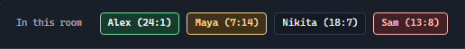

| Color  | Meaning | Description |
|--------|----------|-------------|
| 🟢 Green | Editing | Recent text activity in the shared editor. |
| 🟠 Orange | Selection | A non-empty text selection, including a single-line selection. |
| 🔴 Red | Copy activity | A copy action with selected editor text; this does not verify clipboard write success. |

Editing and copy indicators are brief; the selection indicator follows whether
the participant has a non-empty selection. Copying with no selected text does
not copy the current line.

## Production setup and migration

### Admin credentials and sessions

Generate an Identity password hash offline:

```bash
dotnet run --project tools/password-hash
```

The console prompts without echo. Keep passwords out of command arguments, shell history, source control and logs; keep the generated hashes private too.

For each admin account:

- Configure `AdminUsers__0__Name` and `AdminUsers__0__PasswordHash` through environment variables or a deployment secret provider (adjust the index for additional accounts).
- Remove the legacy `Password` key entirely.

Existing name-only or older authentication tickets require signing in again. Changing a credential or removing an account invalidates authorization after the configuration takes effect.

Sessions last **eight hours**, without sliding extension. Persist ASP.NET Data Protection keys securely if sessions must survive a redeployment.

### HTTPS and reverse proxies

Run behind HTTPS. Production enables HSTS, HTTPS redirection and Secure admin cookies.

When using a reverse proxy:

- Set `TrustedProxies` to the proxy's exact IP addresses.
- Forward the original host and scheme.
- Set `AllowedHosts` to the deployment hostname.

Unlisted proxies cannot supply trusted forwarded headers. The browser WebSocket Origin must match the effective hostname and scheme.

### Deployment and trust boundaries

The application supports **one process only**. Optional PostgreSQL storage persists
the snippet library only; it adds no multi-instance coordination or durable room
storage. Room data disappears when the process stops, even if Data Protection keys are persisted.

Anyone knowing a room link is a trusted participant under [ADR 0003](docs/adr/0003-crdt-recovery-lifecycle.md). The server validates membership, revisions, encoding and resource limits, but does not interpret Yjs updates to verify their document semantics.

### Admin requests and input validation

Admin POST/DELETE requests require an antiforgery token:

1. Fetch a token from `/admin/token`.
2. Send it in `X-CSRF-TOKEN`, or use `__RequestVerificationToken` for a form.
3. Fetch a fresh token after login.

The provided UI handles this automatically.

| Area | Behavior |
| --- | --- |
| API input exceptions | Exceptions handled by the API middleware return ProblemDetails. |
| Hub resource refusals | Stable `LimitExceeded` / `RateLimited` codes. |
| Room names | Trimmed and saved in full, up to 160 characters; longer names and raw inputs over 1024 characters are rejected. |
| Participant names | Trimmed and limited to 64 characters. |

## Resource budgets

### Empty room expiration

Expiration is opt-in. Set `Limits:RoomIdleTimeoutMinutes` to enable it:

| Setting | Default | Valid range |
| --- | --- | --- |
| `Limits:RoomIdleTimeoutMinutes` | `0` (disabled) | 0–525600 minutes |

When enabled, a background service checks **once per minute** and deletes empty rooms whose last activity is at least the configured timeout old. The deletion reason is `Room expired`; expiration occurs at the first sweep after the timeout.

Every successful mutation, including joining and leaving, updates `LastActivityUtc`. `LastUpdatedUtc` continues to track document and metadata changes.

Eligibility is checked again under the room lock before deletion. A concurrent participant join preserves the room if it acquires that lock first.

### Server limits

Configure these values in the `Limits` section:

The section is optional: omitting it keeps the defaults defined in `RoomLimits`.
It does not disable resource limits. These are admission and payload budgets, not
a cap on the process's total RAM or a measured capacity guarantee.

| Setting | Default | Budget |
| --- | --- | --- |
| `MaxEncodedUpdateBytes` | 4 MiB | Base64 characters per update |
| `MaxEncodedCheckpointBytes` | 4 MiB | Base64 characters per checkpoint |
| `MaxJournalBytes` | 4 MiB | Decoded journal bytes |
| `MaxJournalCount` | 2048 | Journal updates |
| `MaxSnapshotCharacters` | 1,048,576 | UTF-16 characters per text snapshot |
| `MaxRooms` | 32 | Rooms per process |
| `MaxConnections` | 160 | Concurrent hub connections |
| `MaxConnectionsPerSource` | `min(20, MaxConnections)` | Concurrent connections per normalized source (1-10000; no greater than `MaxConnections`) |
| `UnjoinedConnectionTimeoutSeconds` | 60 | Deadline to join a room (5-3600 seconds) |
| `NewConnectionsPerSourcePerMinute` | 30 | New connections per source per minute; range 1–10000 |
| `InvocationsPerSecond` | 100 | Hub invocations per connection per second |

For deployments behind shared NAT or proxies, increase `Limits:NewConnectionsPerSourcePerMinute`
and `Limits:MaxConnectionsPerSource` to accommodate reconnect bursts and concurrent users.
A browser tab consumes a connection slot. The 160 global slots exactly match
32 full five-participant rooms and leave no reconnect reserve at that extreme.
Empty rooms still count toward `MaxRooms`; with expiration disabled, delete them
administratively to free slots. The new-connection limiter uses 256 bounded hash
buckets, so unrelated source addresses can share a minute's allowance.
A source is one IPv4 address or one IPv6 /64 prefix. IPv4-mapped IPv6 addresses use
their IPv4 address; missing addresses share `unknown`. Configure `TrustedProxies`
so the source address reflects the intended client boundary. Connections that do
not join a room before `UnjoinedConnectionTimeoutSeconds` are closed.

Defaults were verified with 500,000-character documents. Combined limits must fit a worst-case **16 MiB synchronization response**; invalid settings fail startup.
The tested document size is not a guaranteed maximum for every editing history:
Yjs metadata and locally retained undo content can change checkpoint size.
For example, 4 MiB of Base64 checkpoint data represents roughly 3 MiB of
decoded CRDT state; `MaxSnapshotCharacters` counts UTF-16 code units, not bytes.
An update can temporarily take the live document beyond the snapshot limit.
The editor warns as soon as its text crosses the advertised snapshot length
and offers a local download. It does not reject the edit: the current Monaco
integration cannot intercept every typing, paste, IME and undo operation before
the document changes.
When a checkpoint cannot be written, the journal continues to grow until the
document is reduced or its quota is reached. Use **Download local text** from a
size warning before leaving the tab if changes are unsynced.

### Client limits and quota handling

The browser pending/delivery budgets are **8 MiB / 2048 entries**.

- A permanently oversized update retains visible unsynced text and stops retries.
  **Copy or download the text before reloading.** A full journal triggers a
  checkpoint of the acknowledged server state, then retries queued edits.
- A valid checkpoint frees journal capacity.
- Accepted updates are never evicted to satisfy a quota.

Resource counters are available from the `SealCode.Rooms` and `SealCode.Hub` diagnostic meters without document content.
They include journal size/count, checkpoint outcomes, throttling and active hub
connections. Run a load test on the intended host before sizing the process for
many simultaneously active rooms: a connection count and a 16 MiB message limit
do not bound transient allocations from serialization or document recovery.

### Checkpoint thresholds

| Setting | Default | Valid range |
| --- | --- | --- |
| `CheckpointEveryRevisions` | 64 | 1–10000 revisions |
| `CheckpointEveryBase64Bytes` | 256 KiB | 1024–4194304 Base64 characters |

Startup validation requires both conditions:

```text
4 * CheckpointEveryRevisions <= MaxJournalCount
3 * CheckpointEveryBase64Bytes <= MaxJournalBytes
```

These constraints reserve headroom beyond the doubled fallback threshold for in-flight updates and account for Base64-to-decoded-byte conversion.

## Local assets, publishing and verification

### Building and publishing

The client build clears `wwwroot/assets` before writing the new bundle and chunks.
All HTML references to images, favicons, stylesheets and scripts carry the release
query string `?v=1.20.0`, so releases bypass previously cached resource URLs.
When releasing changed assets, bump this version in all `wwwroot/*.html` pages and the private
`Resources/Snippets/library.html` and `Resources/Snippets/manage.html` pages. Monaco workers inherit it from the room script URL. Admin modules are
bundled too, so their shared imports use content-hashed chunk names.
Stable URLs (HTML, JavaScript entry points and workers) use `Cache-Control: no-cache`
so browsers revalidate them using ETag/Last-Modified. Files with esbuild hashes in
their names are cached for one year with `immutable`.

On a clean checkout, install dependencies first:

```bash
npm ci
```

Build/Publish runs `npm run build:client` automatically. Generated `wwwroot/assets` is ignored by Git and included in publication. Use `SkipClientBuild=true` only when the client build is already prepared.

Monaco, Yjs, SignalR and workers load locally, with a single Yjs instance; no CDN is needed. CSP permits inline styles for Monaco, while scripts and workers must come from this origin.

### CI and test isolation

CI is defined in [verify.yml](.github/workflows/verify.yml).

C# formatting and naming follow [`src/.editorconfig`](src/.editorconfig).
CI verifies the whole solution with `dotnet format --verify-no-changes`, including
the tests and shared TestKit sources. Use `dotnet format src/SealCode.slnx` to apply
automatic fixes, then review the diff. [`.gitattributes`](.gitattributes) pins C#
checkout line endings to CRLF so this check behaves consistently on Windows and Linux.
Top-level types live in files matching their names; project dependencies follow
the [backend architecture](docs/backend.md#2-solution-structure).
JavaScript uses the existing two-space indentation and single-quote convention;
`npm run typecheck` verifies the browser modules without adding a second formatter.

Browser tests use an isolated temporary content root with disposable settings, never local admin credentials.

Coverage reports are separate:

- **Server:** ReportGenerator merges source lines and branches across projects, rather than averaging project percentages.
- **Client:** `c8 --all` covers root `wwwroot/*.js` modules, including
  `room-application.js`, `room-connection.js` and `monaco-adapter.js`. Tests, typedef-only
  `client-types.js`, `*-main.js`, `room.js` and `version.js` are excluded.
  The enforced floors are 68% lines, 87% branches and 90% functions; LCOV is written
  to `coverage/client/lcov.info`. c8 is the only coverage reporter.
  The 80% overall line-coverage goal is now met by tests for room composition,
  connection startup and Monaco adapters. These tests use real Yjs sessions with
  deterministic DOM, editor and transport adapters; browser tests verify rendering.

The [whiteboard verification report](docs/whiteboard-verification.md) records
the feature's regression scenarios, measured coverage and remaining coverage gaps.
The [cursor review](docs/whiteboard-cursors-verification.md) covers server style,
cursor-specific unit, SignalR integration and browser tests, and measured coverage.

### Refreshing the README screenshots

With Node.js 20+, the .NET 10 SDK and the repository dependencies installed:

```bash
npx playwright install chromium
node scripts/capture-readme.mjs
```

To refresh only the dark and light examples with two named remote cursors:

```bash
node scripts/capture-readme.mjs --cursors-only
```

The script builds the client and server, starts an isolated loopback instance
with disposable demo settings, creates three code rooms and one whiteboard, and connects four code-room
participants plus two whiteboard participants.
The demo enables the private question library and captures both its popup and a
separate SQL tab. Typing, selection and copy indicators come from actual editor actions. It replaces
`Room.png`, `UIColors.png` and the images in `docs/images/`, then closes its browser
and server and removes the temporary settings. It does not use or change local
admin credentials or a running deployment. Set `SCREENSHOT_VERSION` to a SemVer
value when preparing release screenshots without a commit suffix.

### Production HTTPS check

Create a development HTTPS certificate, then run the additional production check:

```bash
dotnet dev-certs https
npx playwright test --config playwright.https.config.js
```

The browser test client ignores certificate trust only for that local test certificate.

### Further details

- [Backend architecture](docs/backend.md) — backend mechanisms and real-time collaboration.
- [ADR 0004: Resource and security boundaries](docs/adr/0004-resource-and-security-boundaries.md) — contracts and constraints.
- [Implementation audit](docs/audit-implementation.md) — validation evidence.
