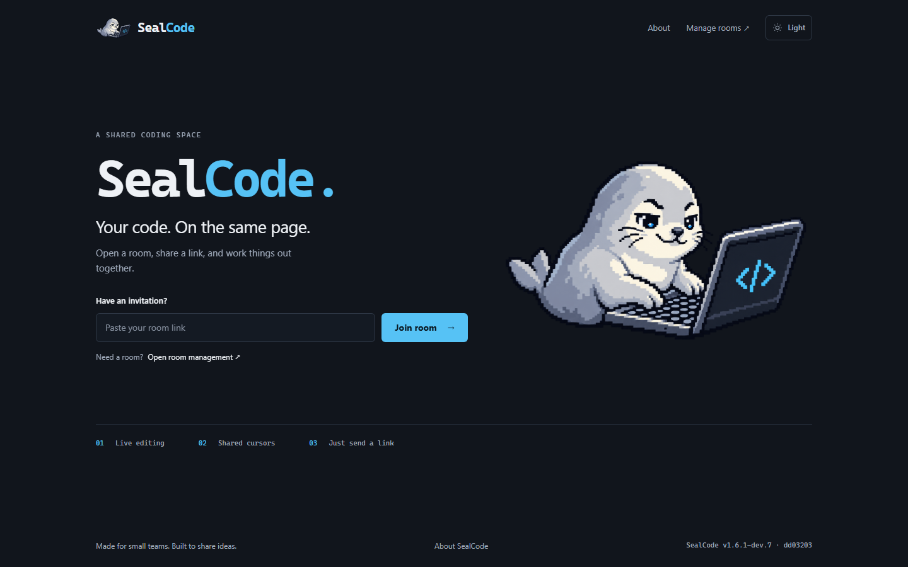
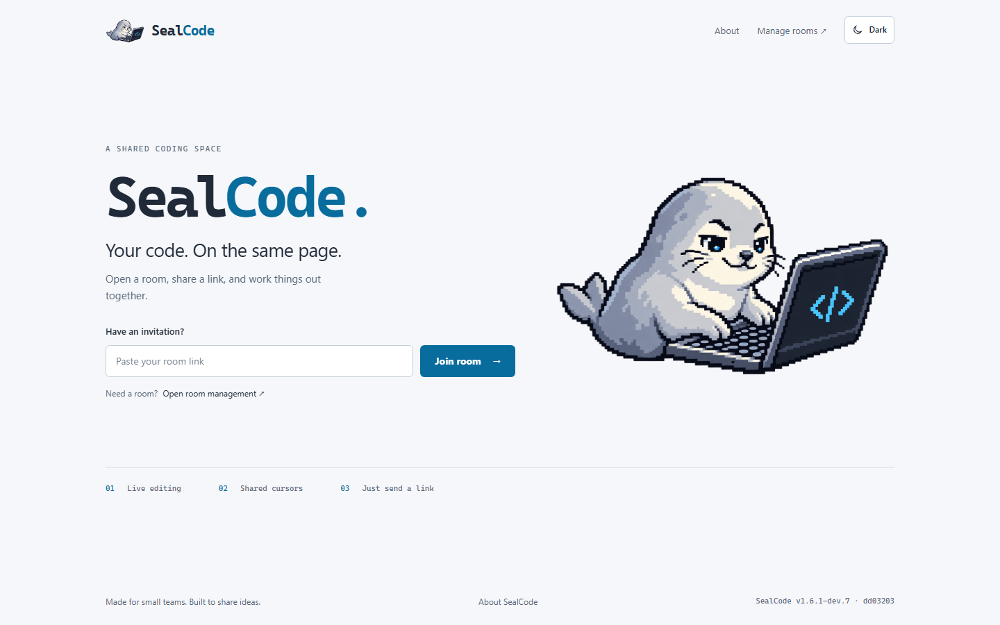
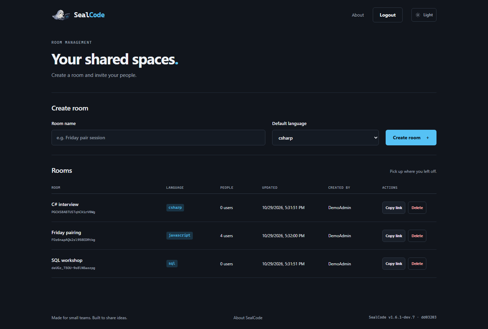
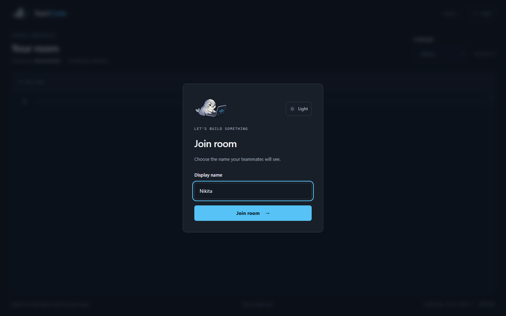
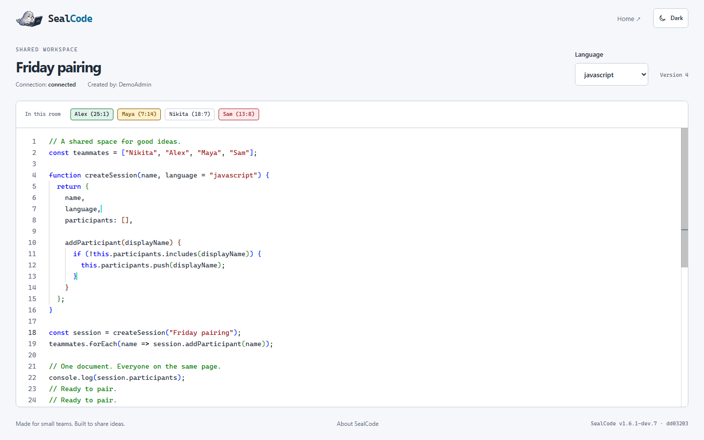
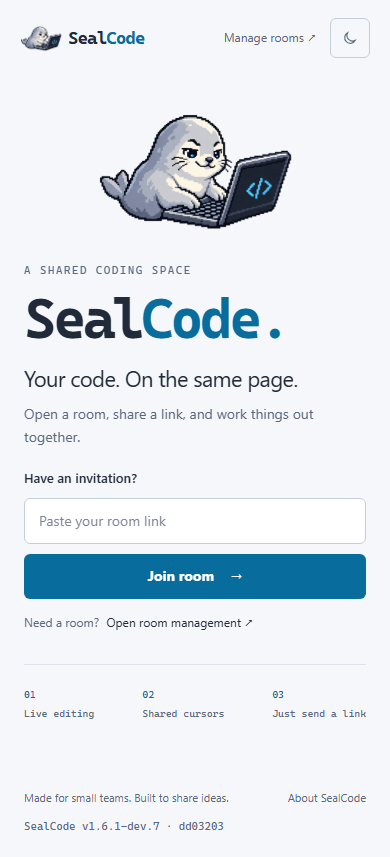
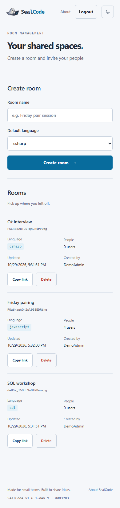
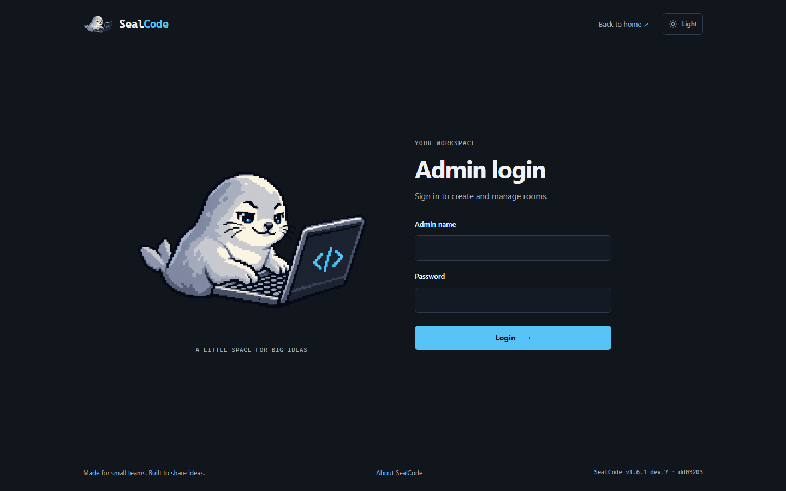

# SealCode

SealCode is a self-hosted collaborative code editor for small, trusted groups, suitable for pair programming, interviews and discussing code together. Each room contains one shared text document, with live editing, participant presence and a shared syntax-highlighting language.

The backend uses ASP.NET Core Minimal API and SignalR on .NET 10; the browser uses Monaco Editor and Yjs for CRDT synchronization. Rooms live entirely in server memory. This is a personal project intended for private use.

For a description of how the backend and real-time collaboration work, see [Backend architecture](docs/backend.md).

[Quick start](#quick-start) · [Screenshots](#screenshots) · [Themes and presence](#themes-and-presence) · [Admin MCP](#admin-mcp)


## Features

- Real-time multi-user editing in Monaco, with syntax highlighting, participant presence and remote cursors.
- Join through an invitation link or paste it on the home page; participants only need a display name, not an account.
- Responsive desktop and mobile layouts with the pixel-art seal identity.
- Dark and light themes across every page and the editor. Dark is the default; the browser remembers the choice and synchronizes it between tabs.
- Selective local undo/redo that preserves concurrent edits from other users.
- Shared language switching by any participant; the checked-in configuration offers C#, SQL and JavaScript.
- Participant list with cursor line/column and typing, selection and copy indicators.
- Automatic reconnection, room rejoin and synchronization recovery, retaining local undo history in the open tab.
- Admin panel to create rooms, copy invitation links, inspect participant counts and delete rooms. Regular admins can delete their own rooms; super admins can delete any room.
- Authenticated MCP tools to list rooms and languages, create rooms with complete invitation URLs, and delete rooms from an MCP client.
- Configurable capacity of 1–5 participants per room, resource budgets and optional expiration of empty rooms.
- Locally bundled browser dependencies and workers; no CDN is required at runtime.
- Build version and commit in the footer, plus an About page with the project repository link.

## Screenshots

These screenshots show the running application with disposable demo accounts and sample room data.

### Home page and themes

Paste a link to join a room, open room management, or change the theme from the header.

| Dark theme (default) | Light theme |
| --- | --- |
|  |  |

### Room management and joining

The admin view shows participant counts, room languages, owners and update times. Guests enter a display name before opening the shared editor.

| Admin room management | Join a shared room |
| --- | --- |
|  |  |

<details>
<summary>Shared editor in light theme</summary>

The editor, participant bar and surrounding controls follow the same theme.



</details>

<details>
<summary>Mobile home and room management</summary>

| Home | Room management |
| --- | --- |
|  |  |

</details>

<details>
<summary>Admin sign-in</summary>



</details>

## Scope and room lifetime

Participants join through a room link and a display name, without an account or password. Anyone with the link can edit the document and change its language, so share links only with trusted participants.

Each room is a single editing buffer: there is no project/file tree, code execution, terminal, Git integration or durable revision history. Copy out any text you want to keep. Closing a tab leaves the room; an empty room remains available until an admin deletes it, an enabled idle timeout expires, or the server stops. Restarting the application loses all rooms and their contents. Deployment supports a single application process.

## Collaboration

SealCode uses Yjs (CRDT) to merge concurrent edits. Each client produces incremental updates that the server broadcasts to the room. The server retains a checkpoint and an update journal for new participants and reconnecting tabs; clients periodically compact the journal with a new checkpoint. These checkpoints are in-memory synchronization state, not saved files or backups.

During a detected disconnection or room rejoin, the editor becomes read-only. After reconnecting, the client merges the room state and retries queued updates. Permanent size/quota failures display a warning to copy unsynced text before reloading. Deleting a room notifies connected participants and disables editing.

## Quick Start

Run the following from the repository root with Node.js 20+ and the .NET 10 SDK installed.

1. Install browser dependencies:

```bash
npm ci
```

2. Generate an admin password hash:

```bash
dotnet run --project tools/password-hash
```

Set `PasswordHash` for **every** admin in `src/SealCode/appsettings.json`, or remove unused admin records. The checked-in configuration has two accounts with empty hashes, so configuring only one is insufficient. See [Configuration](#configuration) for environment-variable overrides.

3. Prepare the local HTTPS certificate and start the application (the build also bundles browser assets):

```bash
dotnet dev-certs https --trust
dotnet run --project src/SealCode/SealCode.csproj
```

4. The checked-in launch profile uses `https://localhost:61670` and `http://localhost:61671`; use the URL shown in your console if overridden. Open `/admin/login`, sign in with a configured admin account, create a room and share its link.

## Tests

Use Node.js 20 or newer for the client build and test runner (CI uses Node.js 24). After `npm ci`, install Chromium once with `npx playwright install chromium`.
Run `npm run build:client` before browser tests. Browser tests build the server and
start their own isolated application instance. Set `E2E_PORT` to override the HTTP
port (5087) or the production HTTPS check port (5088).

| Command | Coverage |
| --- | --- |
| `npm run test:smoke` | Admin login, room creation, multi-user editing, language switching, late join, selective undo, leaving and room deletion |
| `npm run test:client` | Client synchronization, recovery, undo, presence, lifecycle, invitation validation and theme unit tests |
| `npm run test:e2e` | Browser collaboration, recovery, limits, security and UI tests, including smoke |
| `npx playwright test tests/e2e/appearance.spec.js` | Theme persistence and tab synchronization, blocked storage, first-render theme, desktop/mobile layouts, keyboard joining, slow editor loading, and preserving text/selection/undo when changing theme |
| `npm test` | Client unit tests and the browser suite |
| `npm run typecheck` | Static JavaScript type checking |
| `dotnet test src/SealCode.slnx` | Server domain, service, hub, API and configuration tests |

## Admin MCP

The same server exposes admin room management at `/mcp` over Streamable HTTP
using the [official MCP C# SDK](https://csharp.sdk.modelcontextprotocol.io/v2/concepts/transports/transports.html).
Configure a separate `McpToken` next to `PasswordHash` in each `AdminUsers` record:

```json
{
  "Name": "admin",
  "PasswordHash": "<existing Identity V3 hash>",
  "McpToken": "<unique random token of at least 32 characters>",
  "IsSuperAdmin": true
}
```

An absent or empty token disables MCP for that account. Tokens must be unique,
case-sensitive, and contain 32–1024 characters from the
[Bearer token alphabet](https://www.rfc-editor.org/rfc/rfc6750#section-2.1):
letters, digits, `-`, `.`, `_`, `~`, `+`, `/`, with optional trailing `=` padding.
Generate one locally with PowerShell:

```powershell
[Convert]::ToHexString([System.Security.Cryptography.RandomNumberGenerator]::GetBytes(32))
```

Set the token locally in `appsettings.json` or through `AdminUsers__0__McpToken`;
keep real tokens out of commits. Restart the server after changing credentials.
Connect an MCP client to `https://<your-host>/mcp` with this HTTP header:

```text
Authorization: Bearer <McpToken>
```

The endpoint requires the bearer token on every request, independently of admin
browser cookies. It does not require CSRF tokens or a browser login and uses no
server-side MCP sessions. Cross-origin browser requests are rejected; configure
`AllowedHosts` for the public host names used by your deployment.

| Tool | Function |
| --- | --- |
| `list_rooms` | All rooms with names, languages, participant counts, owners, update times, deletion permissions and complete invitation URLs |
| `list_languages` | Allowed languages for room creation |
| `create_room` | Create a room with `name` and optional `language` (default `csharp`); return its ID and complete invitation URL |
| `delete_room` | Delete `roomId` and notify connected participants |

Use `invitationUrl` as the ready-to-share room link, for example
`https://seal-code.com/room/<id>`. It uses the MCP request's scheme, host, port
and application path base. `invitationPath` remains available for existing clients.
Behind a reverse proxy, preserve the public `Host` header and configure
`TrustedProxies` so `X-Forwarded-Proto` from that proxy supplies the public scheme.
The server ignores forwarded headers from untrusted sources.
Room names, language validation, capacity limits and deletion permissions are
the same as in the admin panel. The token identifies its configured admin:
regular admins can delete their own rooms and super admins can delete any room.
Invalid inputs, missing rooms and forbidden deletions return MCP tool errors.

## Admin Workflow

1. Open **Manage rooms** on the home page, or visit `/admin/login`.
2. Sign in with an admin account configured before startup.
3. Enter a room name, choose its default language, and select **Create room**.
4. Use **Copy link** on the room row and share the invitation with participants.

The panel lists all rooms with language, participant count, last update time and
creator. **Delete** closes the room and disconnects its participants. Regular
admins can delete only their own rooms; super admins can delete any room. Use
**Logout** to end the admin session. The same room-management operations are also
available through the [MCP endpoint](#admin-mcp).

## Join a Room

Open an invitation directly, or paste a room link from the same SealCode instance
into the home page and select **Join room**. Invalid links show an inline error.

The join dialog waits for the editor to load before enabling its controls. Enter
a display name and select **Join room**, or press **Enter**. Names are trimmed,
limited to 64 characters and must be unique within the room (case-insensitive).
Joining a full room is rejected.

Inside the room, participants share the document and the **Language** selection.
The header shows the connection state, creator and room version; the participant
bar shows who is present and where they are working. Close the tab or navigate
away to leave. No participant account or installation is required.

## Configuration

- `src/SealCode/appsettings.json`
- `AdminUsers`: unique admin names and Identity V3 `PasswordHash` values. Include `IsSuperAdmin` to allow deleting rooms created by other admins. Legacy `Password` is accepted only in Development.
- `Languages`: list of language identifiers supported by Monaco Editor (example: `csharp`, `sql`).
- `MaxUsersPerRoom`: integer from 1 to 5.
- `CollaborativeUndoEnabled`: optional feature flag; defaults to `true`.

The checked-in `appsettings.json` contains empty `PasswordHash` placeholders. Before starting the app, generate a hash for each admin with `dotnet run --project tools/password-hash` and set its `PasswordHash` locally or through environment variables (for example, `AdminUsers__0__PasswordHash`). Paste the generated hash, not the plain-text password. Empty hashes fail configuration validation. Do not commit your credentials.

## Undo and redo

- `Ctrl+Z` / `Cmd+Z` undoes the current user's latest grouped text operation.
- `Ctrl+Y`, `Ctrl+Shift+Z`, or `Cmd+Shift+Z` redoes it.
- Remote edits are never added to the local undo history.
- Each tab retains up to 100 grouped local operations; reconnect keeps the
  history, while leaving or reloading clears it.

## Synchronization limits

The client reads the server's update, checkpoint and text-snapshot limits from
`/features`. It splits queued edits into batches within `MaxEncodedUpdateBytes`;
if a merged batch is refused, it retries each edit separately before blocking.
Checkpoint state and text are checked against `MaxEncodedCheckpointBytes` and
`MaxSnapshotCharacters` before transmission.

Checkpoint writers wait 1 second and compact at the server-advertised
`Limits:CheckpointEveryRevisions` (default 64) or
`Limits:CheckpointEveryBase64Bytes` (default 256 KiB of Base64 characters). The latest author writes first; other
participants use 2x thresholds as a fallback. Defaults remain well below
the 2048-entry / 4 MiB decoded journal budgets. Accepted checkpoints announce
`YjsCheckpointed(checkpointRevision)` to other participants; stale revisions
are rejected before Base64 decoding, with the locked check remaining authoritative.

- SignalR accepts messages up to 16 MiB. The client checks the complete UTF-8
  JSON message, including the full CRDT state and text in a checkpoint, before sending.
- A checkpoint over the limit is skipped with a visible warning; incremental
  edits continue syncing. After a size refusal, it is reconsidered only after
  another `CheckpointEveryRevisions` revisions.
- An edit over the limit remains local and queued, with a warning to copy the
  text before reloading. Oversized messages are not retried automatically.
- Admin sessions use protected authentication cookies; old name-only cookies
  require signing in again after upgrading.

## Endpoints

- `/` landing page
- `/about.html` about page with repository link
- `/room/{roomId}` room UI
- `/admin` admin panel
- `/admin/login` admin login
- `/admin/logout` admin logout (POST)
- `/admin/rooms` list/create rooms (GET/POST, admin only)
- `/admin/rooms/{roomId}` delete a room (DELETE, owner or super admin)
- `/admin/token` antiforgery token for admin requests
- `/mcp` authenticated admin tools over Streamable HTTP
- `/languages` configured language identifiers
- `/features` collaborative undo flag and synchronization/resource limits
- `/health` health check
- `/version` version and commit of the running build (not cached)
- `/roomHub` SignalR hub

## Version shown in the footer

- MinVer stamps the application from Git tags during Build/Publish, including
  Visual Studio Publish. No deployment script or Git installation on the server is needed.
- Release tags use `v` followed by SemVer, for example `v1.2.0`. Publish after
  the tag is created on the release commit, from a checkout containing Git history and tags.
- Commits after a release receive a `dev` prerelease version automatically.
  The footer shows the version and short commit; its tooltip contains the full build version.
- Publishing without building uses the version already embedded in the existing binaries.
  A build is required after creating a release tag. The footer cannot determine
  uncommitted source changes; publish committed code for an identifiable release.


## Themes and presence

### Appearance

The header's theme button switches the interface and Monaco editor between dark
and light. It is also available in the join dialog; on smaller screens the header
uses a compact sun/moon button. Dark is the default regardless of the operating
system's color preference. The choice is saved in this browser's local storage
under `sealcode.theme`, persists across pages and reloads, and synchronizes between
tabs. If browser storage is blocked, switching still works for the current page.
The preference stays on the client, independently of other participants' themes.
Saved preferences are applied before the page stylesheet loads. Theme changes
preserve the document, selection, and undo history.

### Participant activity

The user's cursor position is displayed in the following format:

`User1 (14:25)`

Where:

- `User1` — the user  
- `14` — the line number  
- `25` — the column number (character position within the line)

Long display names are abbreviated in the participant bar; hover over a label to
see the full name. Colored carets inside the editor identify other participants.
The participant bar uses separate color cues for their current activity:


| Color  | Meaning | Description |
|--------|----------|-------------|
| 🟢 Green | Editing | Recent text activity in the shared editor. |
| 🟠 Orange | Selection | A non-empty text selection, including a single-line selection. |
| 🔴 Red | Copy activity | A copy action with selected editor text; this does not verify clipboard write success. |

Editing and copy indicators are brief; the selection indicator follows whether
the participant has a non-empty selection. Copying with no selected text does
not copy the current line.

## Production setup and migration

### Admin credentials and sessions

Generate an Identity password hash offline:

```bash
dotnet run --project tools/password-hash
```

The console prompts without echo. Keep passwords out of command arguments, shell history, source control and logs; keep the generated hashes private too.

For each admin account:

- Configure `AdminUsers__0__Name` and `AdminUsers__0__PasswordHash` through environment variables or a deployment secret provider (adjust the index for additional accounts).
- Remove the legacy `Password` key entirely.

Existing name-only or older authentication tickets require signing in again. Changing a credential or removing an account invalidates authorization after the configuration takes effect.

Sessions last **eight hours**, without sliding extension. Persist ASP.NET Data Protection keys securely if sessions must survive a redeployment.

### HTTPS and reverse proxies

Run behind HTTPS. Production enables HSTS, HTTPS redirection and Secure admin cookies.

When using a reverse proxy:

- Set `TrustedProxies` to the proxy's exact IP addresses.
- Forward the original host and scheme.
- Set `AllowedHosts` to the deployment hostname.

Unlisted proxies cannot supply trusted forwarded headers. The browser WebSocket Origin must match the effective hostname and scheme.

### Deployment and trust boundaries

The application supports **one process only**. It has no database, multi-instance coordination or durable room storage; room data disappears when the process stops, even if Data Protection keys are persisted.

Anyone knowing a room link is a trusted participant under [ADR 0003](docs/adr/0003-crdt-recovery-lifecycle.md). The server validates membership, revisions, encoding and resource limits, but does not interpret Yjs updates to verify their document semantics.

### Admin requests and input validation

Admin POST/DELETE requests require an antiforgery token:

1. Fetch a token from `/admin/token`.
2. Send it in `X-CSRF-TOKEN`, or use `__RequestVerificationToken` for a form.
3. Fetch a fresh token after login.

The provided UI handles this automatically.

| Area | Behavior |
| --- | --- |
| API input exceptions | Exceptions handled by the API middleware return ProblemDetails. |
| Hub resource refusals | Stable `LimitExceeded` / `RateLimited` codes. |
| Room names | Trimmed and shortened to 20 characters plus an ellipsis; raw inputs over 1024 characters are rejected. |
| Participant names | Trimmed and limited to 64 characters. |

## Resource budgets

### Empty room expiration

Expiration is opt-in. Set `Limits:RoomIdleTimeoutMinutes` to enable it:

| Setting | Default | Valid range |
| --- | --- | --- |
| `Limits:RoomIdleTimeoutMinutes` | `0` (disabled) | 0–525600 minutes |

When enabled, a background service checks **once per minute** and deletes empty rooms whose last activity is at least the configured timeout old. The deletion reason is `Room expired`; expiration occurs at the first sweep after the timeout.

Every successful mutation, including joining and leaving, updates `LastActivityUtc`. `LastUpdatedUtc` continues to track document and metadata changes.

Eligibility is checked again under the room lock before deletion. A concurrent participant join preserves the room if it acquires that lock first.

### Server limits

Configure these values in the `Limits` section:

| Setting | Default | Budget |
| --- | --- | --- |
| `MaxEncodedUpdateBytes` | 4 MiB | Base64 characters per update |
| `MaxEncodedCheckpointBytes` | 4 MiB | Base64 characters per checkpoint |
| `MaxJournalBytes` | 4 MiB | Decoded journal bytes |
| `MaxJournalCount` | 2048 | Journal updates |
| `MaxSnapshotCharacters` | 1,048,576 | UTF-16 characters per text snapshot |
| `MaxRooms` | 32 | Rooms per process |
| `MaxConnections` | 160 | Concurrent hub connections |
| `MaxConnectionsPerSource` | `min(20, MaxConnections)` | Concurrent connections per normalized source (1-10000; no greater than `MaxConnections`) |
| `UnjoinedConnectionTimeoutSeconds` | 60 | Deadline to join a room (5-3600 seconds) |
| `NewConnectionsPerSourcePerMinute` | 30 | New connections per source per minute; range 1–10000 |
| `InvocationsPerSecond` | 100 | Hub invocations per connection per second |

For deployments behind shared NAT or proxies, increase `Limits:NewConnectionsPerSourcePerMinute`
and `Limits:MaxConnectionsPerSource` to accommodate reconnect bursts and concurrent users.
A source is one IPv4 address or one IPv6 /64 prefix. IPv4-mapped IPv6 addresses use
their IPv4 address; missing addresses share `unknown`. Configure `TrustedProxies`
so the source address reflects the intended client boundary. Connections that do
not join a room before `UnjoinedConnectionTimeoutSeconds` are closed.

Defaults were verified with 500,000-character documents. Combined limits must fit a worst-case **16 MiB synchronization response**; invalid settings fail startup.

### Client limits and quota handling

The browser pending/delivery budgets are **8 MiB / 2048 entries**.

- A permanent refusal retains visible unsynced text and stops retries. **Copy the text before reloading.**
- A valid checkpoint frees journal capacity.
- Accepted updates are never evicted to satisfy a quota.

Resource counters are available from the `SealCode.Rooms` and `SealCode.Hub` diagnostic meters without document content.

### Checkpoint thresholds

| Setting | Default | Valid range |
| --- | --- | --- |
| `CheckpointEveryRevisions` | 64 | 1–10000 revisions |
| `CheckpointEveryBase64Bytes` | 256 KiB | 1024–4194304 Base64 characters |

Startup validation requires both conditions:

```text
4 * CheckpointEveryRevisions <= MaxJournalCount
3 * CheckpointEveryBase64Bytes <= MaxJournalBytes
```

These constraints reserve headroom beyond the doubled fallback threshold for in-flight updates and account for Base64-to-decoded-byte conversion.

## Local assets, publishing and verification

### Building and publishing

The client build clears `wwwroot/assets` before writing the new bundle and chunks.
All HTML references to images, favicons, stylesheets and scripts carry the release
query string `?v=1.7.0`, so the redesign bypasses previously cached resource URLs.
When releasing changed assets, bump this version in all five `wwwroot/*.html`
pages. Monaco workers inherit it from the room script URL. Admin modules are
bundled too, so their shared imports use content-hashed chunk names.
Stable URLs (HTML, JavaScript entry points and workers) use `Cache-Control: no-cache`
so browsers revalidate them using ETag/Last-Modified. Files with esbuild hashes in
their names are cached for one year with `immutable`.

On a clean checkout, install dependencies first:

```bash
npm ci
```

Build/Publish runs `npm run build:client` automatically. Generated `wwwroot/assets` is ignored by Git and included in publication. Use `SkipClientBuild=true` only when the client build is already prepared.

Monaco, Yjs, SignalR and workers load locally, with a single Yjs instance; no CDN is needed. CSP permits inline styles for Monaco, while scripts and workers must come from this origin.

### CI and test isolation

CI is defined in [verify.yml](.github/workflows/verify.yml).

Browser tests use an isolated temporary content root with disposable settings, never local admin credentials.

Coverage reports are separate:

- **Server:** ReportGenerator merges source lines and branches across projects, rather than averaging project percentages.
- **Client:** `c8 --all` covers root `wwwroot/*.js` modules, including the untested
  `room-application.js`, `room-connection.js` and `monaco-adapter.js`. Tests, typedef-only
  `client-types.js`, `*-main.js`, `room.js` and `version.js` are excluded.
  The enforced floors are 68% lines, 87% branches and 90% functions; LCOV is written
  to `coverage/client/lcov.info`. c8 is the only coverage reporter.
  The goal is to raise line coverage to at least 80% by covering the browser composition
  and Monaco adapters.

### Refreshing the README screenshots

With Node.js 20+, the .NET 10 SDK and the repository dependencies installed:

```bash
npx playwright install chromium
node scripts/capture-readme.mjs
```

The script builds the client and server, starts an isolated loopback instance
with disposable demo settings, creates three rooms, and connects four participants.
Typing, selection and copy indicators come from actual editor actions. It replaces
`Room.png`, `UIColors.png` and the images in `docs/images/`, then closes its browser
and server and removes the temporary settings. It does not use or change local
admin credentials or a running deployment.

### Production HTTPS check

Create a development HTTPS certificate, then run the additional production check:

```bash
dotnet dev-certs https
npx playwright test --config playwright.https.config.js
```

The browser test client ignores certificate trust only for that local test certificate.

### Further details

- [Backend architecture](docs/backend.md) — backend mechanisms and real-time collaboration.
- [ADR 0004: Resource and security boundaries](docs/adr/0004-resource-and-security-boundaries.md) — contracts and constraints.
- [Implementation audit](docs/audit-implementation.md) — validation evidence.
