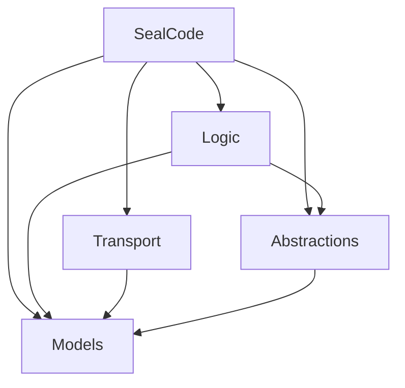
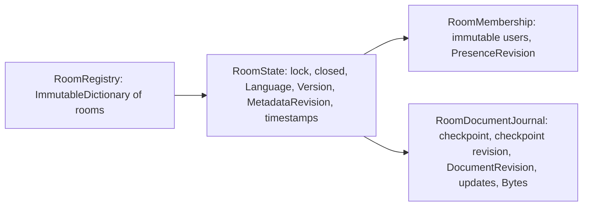
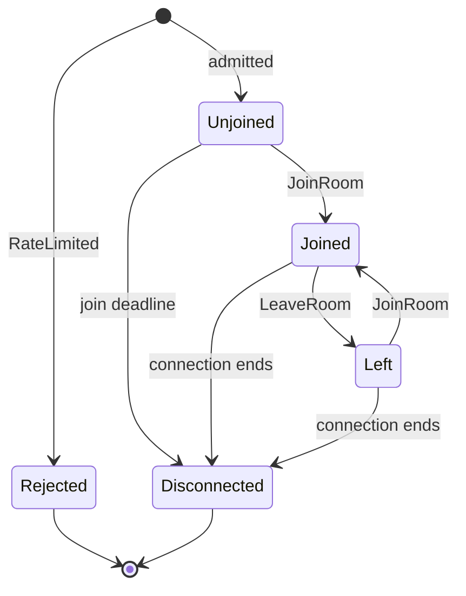
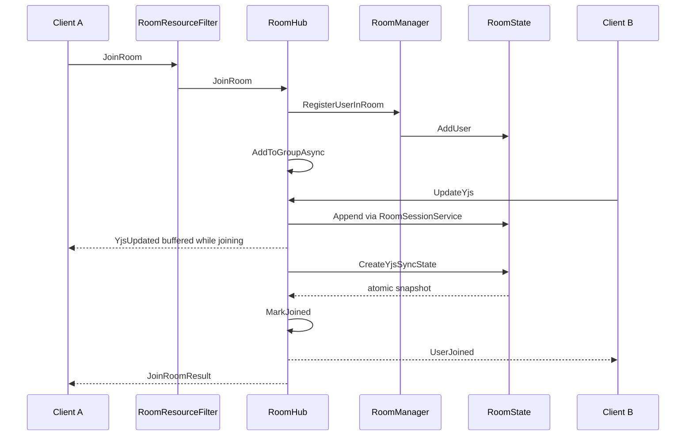
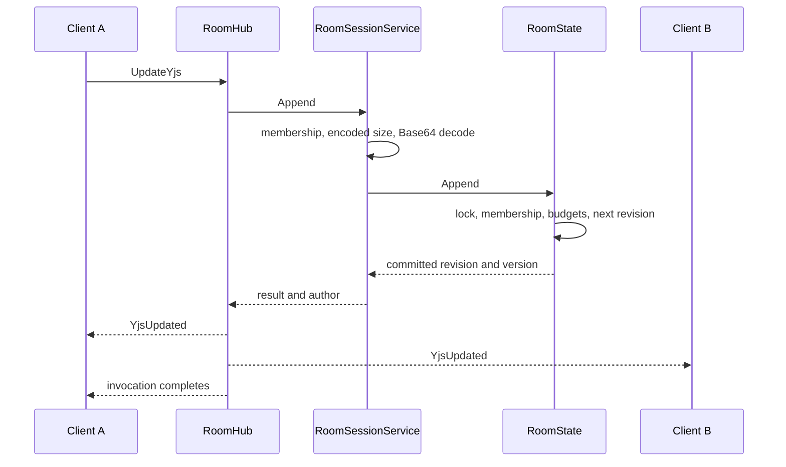
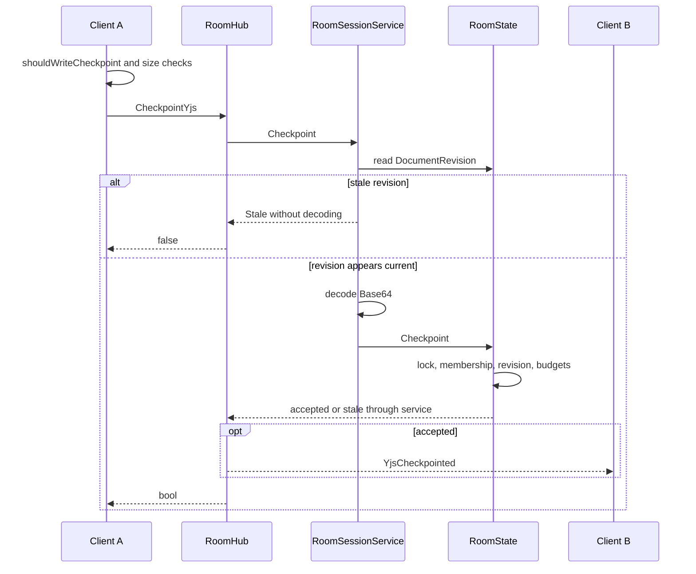
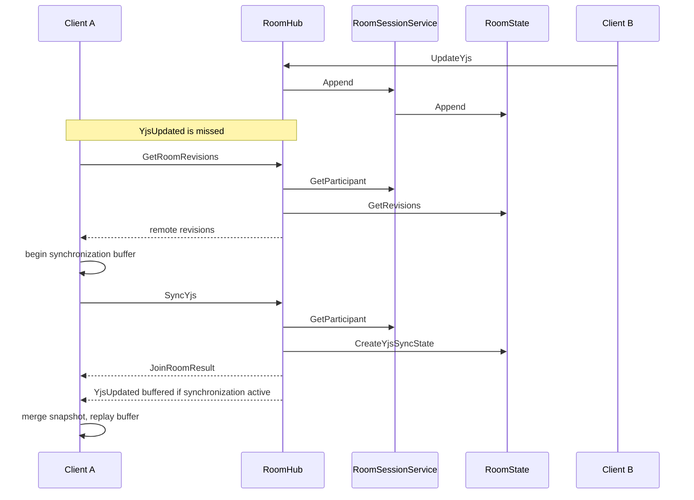
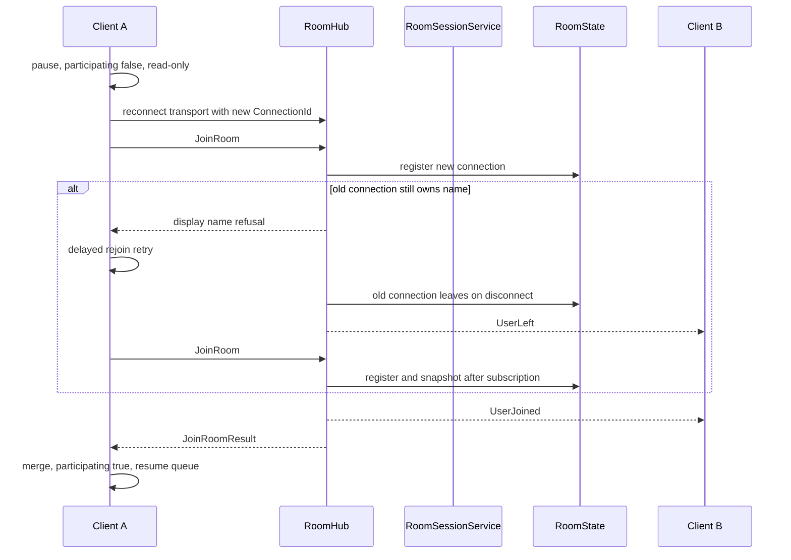
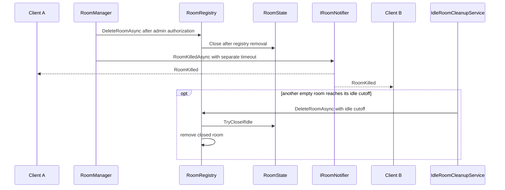

# Backend architecture

## 1. Overview

SealCode is an ASP.NET Core Minimal API and SignalR application targeting .NET 10.
One application process owns all rooms in memory. A room is one shared editing
buffer, its language, and its participants.

The server coordinates collaboration; the browser performs the CRDT merge using
Yjs. The server does not interpret CRDT operations. It retains opaque Yjs update
bytes and a client-supplied checkpoint, assigns document revisions, broadcasts
changes, tracks membership, and enforces resource budgets.

The checkpoint is synchronization state, not a saved document or backup.
Its accompanying plain text is also client supplied and can lag incremental
updates until the next accepted checkpoint.

Participants who know the room link are trusted to provide valid CRDT contents.
See [ADR 0003](adr/0003-crdt-recovery-lifecycle.md) for this trust boundary and
[ADR 0001](adr/0001-selective-collaborative-undo.md) for selective undo decisions.
Persistence, multiple application instances, durable revision history, and
server-side semantic validation of CRDT contents are outside the implementation.

Source entry points are [Program.cs](../src/SealCode/Program.cs),
[RoomHub](../src/SealCode/RoomHub.cs), and
[RoomState](../src/Models/RoomState.cs).
Deployment and default values remain in the
[README](../README.md#production-setup-and-migration).

## 2. Solution structure

| Component | Responsibility and key types | Project dependencies |
| --- | --- | --- |
| Models | Domain values, configuration, aggregate invariants: RoomState, RoomMembership, RoomDocumentJournal, RoomLimits | None |
| Abstractions | Application boundaries: IRoomRegistry, IRoomManager, IRoomSessionService, IRoomNotifier | Models |
| Logic | Application operations: RoomSessionService, RoomManager, RoomRegistry | Abstractions, Models |
| Transport | HubContract, JoinRoomResult, YjsDocumentUpdate, JSON conversion | Models |
| SealCode | Composition, HTTP, SignalR, security, browser assets: RoomHub, RoomResourceFilter, SignalRRoomNotifier | Logic, Abstractions, Models, Transport |
| TestKit | Shared RoomStateBuilder and Concurrency helpers, compiled into selected test projects | Shared source directory; no separate project |

Diagram 1 shows production project references; each arrow points from a project
to a project it references.



Logic calls the IRoomNotifier interface defined in Abstractions. SealCode supplies
its SignalRRoomNotifier implementation through dependency injection, so Logic
does not reference SignalR or the SealCode project. TestKit is shared test source,
not a project reference, and is described in the table above.

[RoomState](../src/Models/RoomState.cs) owns the aggregate lock. Its internal
[RoomMembership](../src/Models/RoomMembership.cs) and
[RoomDocumentJournal](../src/Models/RoomDocumentJournal.cs) own the participant
collection and document storage respectively, without independent mutation locks.

[RoomSessionService](../src/Logic/RoomSessionService.cs) coordinates participant
operations, payload validation, decoding, and the mutation clock.
[RoomManager](../src/Logic/RoomManager.cs) coordinates registration and authorized
room deletion; [RoomRegistry](../src/Logic/RoomRegistry.cs) stores rooms.

[RoomHub](../src/SealCode/RoomHub.cs) adapts those operations to SignalR groups,
wire errors and notifications. Protocol names live in
[HubContract](../src/Transport/HubContract.cs), error translation in
[HubErrors](../src/SealCode/Hub/HubErrors.cs), and connection budgets in
[RoomResourceFilter](../src/SealCode/RoomResourceFilter.cs).

## 3. HTTP pipeline and endpoints

[Program.cs](../src/SealCode/Program.cs) registers the following explicit pipeline
in order. Endpoint mapping describes route registration, not separate middleware
executed once for every route.

1. Forwarded headers apply trusted proxy information before origin and HTTPS checks.
2. HSTS and HTTPS redirection run whenever the environment is not Development,
   including Production.
3. ApiExceptionMiddleware maps selected input exceptions to HTTP 400
   ProblemDetails and RoomLimitException to HTTP 409 ProblemDetails.
4. SecurityHeadersMiddleware applies the CSP and nosniff header.
5. WebSocketOriginGuardMiddleware rejects malformed or different browser origins
   on WebSocket upgrades under the hub path. A missing Origin is allowed.
6. Default-file rewriting and static files serve the browser assets.
   StaticAssetCaching revalidates stable names and caches hashed assets.
7. Cookie authentication resolves the admin identity.
8. AdminHttpSecurity.InvokeAsync validates the antiforgery token for every POST
   and DELETE under `/admin` and answers HTTP 400 when it is missing or invalid.
   Login throttling is not part of this middleware: it is the endpoint filter
   AdminHttpSecurity.FilterLoginAsync attached to the login route. Static admin
   HTML is served by step 6, before this policy runs.
9. MapSealCodeEndpoints and MapAdminEndpoints register HTTP routes.
10. MapHub registers RoomHub at `/roomHub`.

| Public route | Successful response | Explicit Cache-Control policy |
| --- | --- | --- |
| `/room/{roomId}` | room.html for an existing room; missing room returns 404 | no-cache on the HTML response |
| `/features` | CollaborativeUndoEnabled, MaxYjsMessageBytes and Limits | None set by this endpoint |
| `/languages` | Configured language identifiers | None set by this endpoint |
| `/health` | JSON string "ok" | None set by this endpoint |
| `/version` | Running assembly version information | no-store |

These routes are mapped by
[EndpointRouteBuilderExtensions.MapSealCodeEndpoints](../src/SealCode/Hosting/EndpointRouteBuilderExtensions.cs).
The room route uses the ShortGuid route constraint; a malformed identifier does
not match that endpoint. Serving the room page does not register a participant.

[StaticAssetCaching.Apply](../src/SealCode/Hosting/StaticAssetCaching.cs) sets
no-cache for HTML and stable asset names; matching hashed non-HTML names get
public, max-age=31536000, immutable. This static-file policy does not implicitly
apply to JSON endpoints.

[readClientLimits](../src/SealCode/wwwroot/client-limits.js) accepts PascalCase
and camelCase fields and uses positive safe integers, falling back otherwise.
It reads MaxEncodedUpdateBytes for batching, MaxEncodedCheckpointBytes and
MaxSnapshotCharacters for checkpoint validation, CheckpointEveryRevisions and
CheckpointEveryBase64Bytes for compaction scheduling, plus the top-level
MaxYjsMessageBytes for complete SignalR message checks. Other server Limits
fields are exposed but are not consumed by this reader.

Room creation and administration use cookie authentication and antiforgery
validation. See the [admin workflow](../README.md#admin-workflow) and
[endpoint list](../README.md#endpoints). Admin pages, login/logout and room
management are implemented in [AdminEndpoints](../src/SealCode/Routing/AdminEndpoints.cs);
the antiforgery token endpoint `/admin/token` is mapped by MapSealCodeEndpoints
and answers with Cache-Control: no-store.

## 4. Room model

RoomState is the aggregate. Its single lock serializes successful joins,
departures, document appends, checkpoints, metadata changes, synchronization
snapshots, and closure. It protects the relationships among:

- membership and its presence revision;
- checkpoint, incremental journal, and document revision;
- language and metadata revision;
- Version, LastUpdatedUtc, and LastActivityUtc;
- the closed flag.

| Revision | Changes when | Client use |
| --- | --- | --- |
| DocumentRevision | An incremental update is accepted | Detect gaps and duplicates; qualify checkpoints |
| MetadataRevision | ChangeLanguage succeeds, including setting the same language | Reject older language events independently of document updates |
| PresenceRevision | A connection is added or removed | Reject older participant snapshots |
| Version | Append or ChangeLanguage succeeds | Combined room version shown in the UI; not a substitute for stream revisions |

Document and metadata revisions start at zero; new rooms start with Version one.
A checkpoint neither advances DocumentRevision nor Version. An idempotent join
does not advance PresenceRevision, but AddUser still refreshes activity.

[RevisionedRoomView](../src/SealCode/wwwroot/room-presence.js) tracks language and
presence independently and rejects lower revisions; equal revisions are allowed.
[YjsSession](../src/SealCode/wwwroot/yjs-session.js) separately tracks the
contiguous document revision and the highest document revision seen.
A text update cannot make a newer language event appear obsolete.

Diagram 2 shows the storage relationships and the state owned by the aggregate.



RoomDocumentJournal retains a full checkpoint at YjsCheckpointRevision and a
List of updates accepted afterwards. Append checks size/count budgets before
advancing DocumentRevision and adding the update. Accepted entries are not evicted
to admit later updates.

TryCheckpoint accepts only the current document revision, copies the checkpoint,
records its revision, and clears incremental entries and their metric balances.
RoomState.Checkpoint also replaces Text and refreshes timestamps. It does not
verify that the Yjs bytes and text represent the claimed revision semantically.

RoomState.Close marks the aggregate closed and calls the journal's Clear.
Clear removes incremental updates and resets byte/count balances; it does not
erase the checkpoint or reset revision counters. Membership is not cleared by
Close. Through remaining references, joins, appends, checkpoints, language changes
and synchronization snapshots are rejected with RoomNotFoundException
(EnsureOpen/RequireParticipant). Leave deliberately has no closure check, so
disconnect cleanup can still remove membership on a closed room; it advances
PresenceRevision as usual. Cursor, selection and copy broadcasts do not consult
the closed flag; they rely on the registry lookup, and a deleted room is removed
from the registry before it is closed.

RoomRegistry stores rooms in an immutable dictionary. CreateRoom checks MaxRooms
and inserts under its capacity lock. Normal deletion removes the registry entry
and then closes the aggregate. Expiration first calls TryCloseIfIdle under the
room lock, then finishes removal without shutdown cancellation interrupting it.

TryCloseIfIdle requires an open room with no participants and activity at or
before the cutoff. A join that wins the lock prevents expiration; a join after
closure fails. Registry lookups alone do not reserve an open room.

## 5. Hub contract

The tables describe wire names from
[HubContract.Methods and HubContract.Events](../src/Transport/HubContract.cs).
The C# asynchronous implementations commonly have an Async suffix; their
HubMethodName attributes retain the wire names below.

All invocations pass through the per-connection rate filter. In the method table,
I means InvalidInput, N means RoomNotFound, P means NotParticipant, and L means
LimitExceeded. Every method can additionally be refused with RateLimited.
Unexpected framework/transport failures are not mapped to these categories.

| Method | Caller | Parameters → result | Events after success | Expected domain/input errors |
| --- | --- | --- | --- | --- |
| JoinRoom | Any admitted connection; leave the current room before switching | roomId, displayName → JoinRoomResult | UserJoined | I, N |
| UpdateYjs | Participant | roomId, updateBase64 → no value | YjsUpdated | I, N, P, L |
| GetDocumentRevision | Participant | roomId → long | None | I, N, P |
| GetRoomRevisions | Participant | roomId → RoomRevisions | None | I, N, P |
| SyncYjs | Participant | roomId → JoinRoomResult | None | I, N, P |
| CheckpointYjs | Participant | roomId, stateBase64, textSnapshot, basedOnRevision → bool | YjsCheckpointed only when true | I, N, P, L |
| SetLanguage | Participant | roomId, language → no value | LanguageUpdated | I, N, P |
| UpdateCursor | Participant to broadcast; nonparticipant silently ignored | roomId, position → no value | CursorUpdated | I, N |
| UpdateSelection | Participant to broadcast; nonparticipant silently ignored | roomId, isMultiLine → no value | UserSelection | I, N |
| UpdateCopy | Participant to broadcast; nonparticipant silently ignored | roomId → no value | UserCopy | I, N |
| LeaveRoom | Any admitted connection; absent membership is harmless | roomId → no value | UserLeft only after actual removal | I |

GetDocumentRevision and LeaveRoom remain in the contract but are not invoked by
the bundled browser. It probes GetRoomRevisions and leaves by closing/stopping
the connection. See [room-application.js](../src/SealCode/wwwroot/room-application.js)
and [room-lifecycle.js](../src/SealCode/wwwroot/room-lifecycle.js).

JoinRoomResult contains Name, Language, Text, Version, Users, CreatedBy,
DocumentRevision, CheckpointRevision, YjsState, YjsUpdates, MetadataRevision,
and PresenceRevision. Each YjsUpdates item carries Revision and Update.
YjsState is null when there is no checkpoint. Text reflects the checkpoint text,
not a server reconstruction of the incremental tail.

[JoinRoomResult.From](../src/Transport/Models/JoinRoomResult.cs) gets one atomic
RoomState.CreateYjsSyncState snapshot, then converts its copied payloads to
Base64 outside the aggregate lock. HTTP and SignalR JSON are configured to retain
property names in [ServiceCollectionExtensions](../src/SealCode/Hosting/ServiceCollectionExtensions.cs).

| Event | Recipients | Positional arguments | Browser purpose |
| --- | --- | --- | --- |
| UserJoined | GroupExcept joining connection | displayName, users, presenceRevision | Update participant list and join indication |
| YjsUpdated | Group, including author | updateBase64, documentRevision, roomVersion, author | Apply CRDT update, track revisions and checkpoint writer |
| YjsCheckpointed | GroupExcept checkpoint writer | checkpointRevision | Retire accounted journal entries for checkpoint scheduling |
| LanguageUpdated | Group, including initiator | language, roomVersion, metadataRevision | Reconcile shared language |
| CursorUpdated | GroupExcept initiator | displayName, position | Display cursor position |
| UserSelection | GroupExcept initiator | displayName, isMultiLine | Display selection activity |
| UserCopy | Group, including initiator | displayName | Display copy activity |
| UserLeft | GroupExcept departing connection | displayName, users, presenceRevision | Reconcile membership and remove departed presence |
| RoomKilled | Group | reason | Close the local session and retain visible text for copying |

Recipients are selected explicitly in RoomHub; RoomKilled is sent by
[SignalRRoomNotifier.RoomKilledAsync](../src/SealCode/SignalRRoomNotifier.cs).
In particular, UserCopy includes its initiator, unlike CursorUpdated and
UserSelection. Neither UserJoined nor YjsCheckpointed echoes to its initiator.

### Errors and retry classification

[HubErrors.Create and HubErrors.Translate](../src/SealCode/Hub/HubErrors.cs) define
these categories and wire formats:

| HubErrorCode | Wire text | Client classification | Client action |
| --- | --- | --- | --- |
| InvalidInput | InvalidInput: followed by details, or legacy unprefixed input text | Substring `InvalidInput` anywhere in the text; legacy unprefixed text stays unclassified | No dedicated handling: join/rejoin errors display the server text; queues retry it like any temporary failure |
| LimitExceeded | LimitExceeded: followed by resource label | Substring `LimitExceeded` or `too large` | Merged batch: split into single sends. Single update: permanent, queue blocked, editor read-only. Checkpoint: deferred by retryAfterRevisions |
| RateLimited | RateLimited: Connection capacity reached; RateLimited: Try again later | Substring `RateLimited` | Temporary; update queue retries after 1100 ms |
| RoomNotFound | Room not found | Text `Room not found` | Terminal: RoomLifecycle.closeRoom |
| NotParticipant | Join the room before changing it | Exact membership message | Treated as temporary: update queue retries after 500 ms, checkpoint/recovery reschedule. It does not trigger a rejoin by itself; rejoin is driven by reconnect and online events |

Legacy unprefixed messages include:

- Invalid room id
- Invalid language
- Invalid cursor position
- Leave the current room before joining another room
- Leave the room before changing display name.
- Room is full (max N), with the configured participant limit substituted
- Display name already in use. Choose another name.
- Update payload required
- State payload required
- Invalid document revision
- Invalid Yjs payload

Invalid display names use the prefixed message InvalidInput: Invalid display name.
ArgumentNullException and ArgumentException with a parameter name translate to
InvalidInput: Invalid room input. Other ArgumentException messages keep their
legacy unprefixed form. RoomLimitException supplies the resource label:
Update size, Checkpoint size, or the aggregate's generic resource-budget message.

RoomHub uses HubErrors.Invoke around application operations. RoomResourceFilter
also translates known exceptions escaping invocations; unknown exceptions are
re-thrown. Not every rejection is a hub invocation error: origin checks happen
before connection admission, and oversized transport messages can fail at SignalR.

[classifyHubError](../src/SealCode/wwwroot/hub-errors.js) searches error text,
including SignalR wrappers. It recognizes LimitExceeded or "too large", then
RateLimited, InvalidInput, Room not found, and the membership message. It returns
null for other text, including several legacy validation messages.

[UpdateQueue](../src/SealCode/wwwroot/room-sync.js) switches to individual sends
only when a merged batch is refused with LimitExceeded or merging itself fails;
the refused batch is then sent one update at a time, after which batching
resumes. Other failures (RateLimited, NotParticipant, transport errors) re-queue
the batch unchanged, and it is merged again on retry. A LimitExceeded refusal of a
single update blocks the queue, keeps pending edits, makes the editor read-only and
shows a copy-before-reload warning (see
[room-application.js](../src/SealCode/wwwroot/room-application.js) and
[ADR 0004](adr/0004-resource-and-security-boundaries.md)). RateLimited retries after
1100 ms; other send failures retry after 500 ms. CheckpointWriter treats
LimitExceeded as a size refusal and waits for more revisions before reconsidering
it. RoomLifecycle handles RoomNotFound as terminal rather than retrying indefinitely.

Keep [HubContract.cs](../src/Transport/HubContract.cs),
[hub-contract.js](../src/SealCode/wwwroot/hub-contract.js), and
[HubContract.Tests](../src/SealCode.Tests/HubContract.Tests.cs) synchronized.
HubContract.Tests checks two things: the C# and JavaScript name/value maps are
identical, and every `[HubMethodName]` on RoomHub appears in the contract. It does
not verify that every contract method is implemented, nor parameter lists or event
arguments; those are covered only by RoomHub, API and browser tests.

## 6. Connection lifecycle

[RoomResourceFilter.OnConnectedAsync](../src/SealCode/RoomResourceFilter.cs)
admits connections in this order:

1. Acquire from the normalized source's fixed-window rate bucket.
2. Acquire a global MaxConnections semaphore permit without waiting.
3. Under the source lock, check and increment MaxConnectionsPerSource accounting.

Failure reports RateLimited: Connection capacity reached and increments
hub.throttled. Source-capacity refusal releases the global permit immediately.
The fixed-window rate permit from step 1 is consumed even when step 2 or 3 then
refuses the connection, so refused attempts count against the source's
new-connection budget. No participant registration has happened at admission time.

The rate buckets are a fixed array of 256 limiters selected by a string hash.
Unrelated sources can collide and share a new-connection rate budget. Concurrent
source counts, in contrast, use the actual normalized address as the key.

[ConnectionSource.From](../src/SealCode/Hosting/ConnectionSource.cs) uses the IPv4
address, maps IPv4-mapped IPv6 to IPv4, and zeroes the lower 64 bits of IPv6.
Missing addresses share the unknown key. The remote address comes from the HTTP
context after forwarded-header processing.

[TrustedProxyOptions.Configure](../src/SealCode/Hosting/TrustedProxyOptions.cs)
clears implicit trusted proxies/networks and enables X-Forwarded-For and
X-Forwarded-Proto only when TrustedProxies contains configured addresses.
Correct proxy setup therefore determines which source boundary is counted.
See [proxy configuration](../README.md#https-and-reverse-proxies).

After admission the filter records connectionSource and connectionPermit in
Context.Items, creates a one-shot unjoinedTimer using TimeProvider, and creates
an invocationLimiter. The deadline aborts the connection if HasJoinedRoom is
false when it fires.

JoinRoomAsync calls MarkJoined after group subscription and snapshot success,
before broadcasting UserJoined. This writes joinedOnce. ClearActiveRoom removes
roomId and displayName, but leaves joinedOnce. Consequently the deadline checks
whether the connection ever joined successfully; it is not restarted after
LeaveRoom and does not enforce a maximum duration outside a room afterwards.

InvokeMethodAsync attempts an invocation permit without queuing. Refusal reports
RateLimited: Try again later; otherwise the method executes and known exceptions
are translated. Fixed-window replenishment means this is a window budget, not
a sliding measurement of every possible one-second interval.

Diagram 3 shows admission, the initial deadline, and membership transitions.



A repeated JoinRoom on the same connection with the same name keeps the
connection in Joined (idempotent registration). RoomKilled does not change
server-side membership: the browser reacts by stopping its connection, so the
transition is Joined → Disconnected. Disconnect cleanup then finds no room in the
registry and returns without a UserLeft event.

SignalR liveness settings decide how quickly a dead connection reaches
Disconnected. The server uses KeepAliveInterval 5 s and ClientTimeoutInterval 15 s
([AddSealCodeSignalR](../src/SealCode/Hosting/ServiceCollectionExtensions.cs)).
The browser uses keepAliveIntervalInMilliseconds 5000, serverTimeoutInMilliseconds
15000 and automatic reconnect that retries indefinitely every 3 s (2 s while the
browser reports offline), see
[createRoomConnection](../src/SealCode/wwwroot/room-connection.js). Until the
server times out an abandoned connection, that connection keeps its display name
and its participant slot.

RoomHub.OnDisconnectedAsync calls RemoveFromRoomAsync for the active room.
Leave commits membership removal and its matching user snapshot under the room
lock. UserLeft uses CancellationToken.None; removal from the SignalR group also
ignores the disconnected caller's cancellation token.

If group removal fails, the hub restores relevant active-room cleanup context
so a later disconnect cleanup can retry. Already-removed membership does not
produce another UserLeft event. If the registry no longer contains the room,
cleanup returns after clearing active context.

The filter invokes disconnect handling and releases resources in finally.
Release removes each Context.Items entry before disposing the timer/limiter or
returning permits, preventing sequential repeated cleanup from returning a slot
twice. Initialization failures after permit recording also call Release.
This covers partially initialized connections, including limiter creation failure.

## 7. Collaboration scenarios

### Joining a room

Diagram 4 shows group subscription before the atomic synchronization snapshot.



RoomManager.RegisterUserInRoom calls RoomState.AddUser. The aggregate checks
closure, capacity, and case-insensitive name uniqueness together. The hub then
records the active room and subscribes to the SignalR group before calling
JoinRoomResult.From.

The ordering closes the snapshot/subscription window: a concurrent accepted
update can be represented in the snapshot or delivered live to the synchronization
buffer, possibly both. Actual event delivery remains fallible; revision recovery
is still required.

On AddToGroupAsync failure, a newly registered participant is removed and active
context is cleared. If subscription succeeded but the room closes before snapshot
creation, snapshot creation throws; rollback also attempts group removal with
CancellationToken.None and logs any cleanup failure. The rollback calls
RoomState.Leave, which advances PresenceRevision without a UserLeft event; other
participants reconcile that revision on their next GetRoomRevisions probe.

For an existing active membership, wasMember prevents rollback from removing that
pre-existing registration. Same-connection, same-name registration is idempotent;
changing the display name requires leaving. A successful repeat still takes a
fresh snapshot and broadcasts UserJoined with the unchanged presence revision.

### Appending an edit

Diagram 5 shows the commit boundary before the broadcast attempt.



RoomSessionService.Append rejects a missing payload, checks participant access
and encoded length, then decodes Base64 outside the room lock. RoomState.Append
rechecks membership and closure under that lock. RoomDocumentJournal.Append
checks canonical encoded size, decoded journal bytes, and entry count before
advancing the revision.

The room increments Version and timestamps on commit. Only afterwards does
RoomHub.UpdateYjsAsync broadcast through BroadcastAfterCommitAsync. It uses
CancellationToken.None because an accepted update belongs to the room even if
its author disconnects. A non-fatal send exception is logged and swallowed;
the journal entry and revision remain committed. The caller's successful result
therefore does not prove that every peer received the event.

### Writing a checkpoint

Diagram 6 shows optimistic stale rejection followed by the authoritative locked check.



[shouldWriteCheckpoint](../src/SealCode/wwwroot/room-sync.js) lets the latest seen
author write at either advertised threshold; other participants use doubled
thresholds. The application sets the writer delay to one second. Readiness also
requires a caught-up contiguous revision, participation, a document, and no
pending/in-flight/blocked outgoing edits.

RoomSessionService.Checkpoint validates the revision, required state, membership,
encoded checkpoint size and text length before its optimistic revision check.
A stale request within those size limits returns false without decoding.
It then decodes Base64 and calls RoomState.Checkpoint.

Under the aggregate lock, membership/closure and the current revision are checked
again. Only a current checkpoint replaces retained state and clears the tail.
An update accepted during decoding therefore makes the checkpoint stale instead
of allowing it to erase that update. Accepted checkpoints notify other clients
through YjsCheckpointed and update the writer's local tracker from the result.

Client size checks cover the encoded state, text length, and complete UTF-8 JSON
SignalR message. A LimitExceeded refusal records skippedRevision; retryAfterRevisions
is set from CheckpointEveryRevisions, deferring reconsideration until enough
additional revisions arrive. Incremental synchronization can continue.

### Detecting gaps and recovering

Diagram 7 shows a missed update being recovered by a participant-only snapshot
while concurrent live updates are buffered.



YjsSession.noteDocumentRevision tracks contiguous arrivals separately from the
highest seen revision. A gap schedules recovery after 250 ms. SnapshotRecovery
also probes GetRoomRevisions on its normal five-second schedule, detecting a
missing final event even when no later update exposes a gap.

If any remote stream is ahead, SyncYjs returns the same snapshot shape as a join
without re-registering membership or broadcasting UserJoined. During recovery,
receiveUpdate buffers events. The client merges the checkpoint and tail into its
existing Y.Doc with the bootstrap origin, applies independent language/user
revisions, then sorts and replays buffered document events.

The document and UndoManager are retained, preserving local undo and unsent local
CRDT changes. Session/connection/epoch checks discard stale async completions.
The delivery buffer is bounded; overflow discards that buffer and schedules a
fresh recovery rather than deleting authoritative server updates.
See [ADR 0003](adr/0003-crdt-recovery-lifecycle.md).

### Reconnecting and rejoining

Diagram 8 shows participation being restored only after a successful JoinRoom.



[createRoomConnection](../src/SealCode/wwwroot/room-connection.js) enables automatic
SignalR reconnect. A replacement connection is registered using its new
ConnectionId. RoomLifecycle.pause clears participating, resets transport
scheduling, and makes the editor read-only while retaining the document.

The old connection can still occupy the name/capacity until disconnect cleanup,
which for an abandoned transport happens only after the server's 15 s client
timeout (see [Connection lifecycle](#6-connection-lifecycle)). Rejoin retries use delays of 500, 1000, 2000, 5000, and then 10000 ms.
Only a successful join sets participating true. Sending is gated by
canSendUpdates, so local updates already produced remain queued until the room
membership and synchronization snapshot are restored.

Browser offline/online events use the same participation gate even if the
WebSocket still reports Connected. Offline pauses participation; online reissues
JoinRoom on that live connection when necessary. Same-connection registration
is idempotent, so this also refreshes synchronization without duplicate membership.

### Language, cursor, selection and copy

SetLanguage delegates to RoomSessionService.ChangeLanguage and then
RoomState.ChangeLanguage. Under the aggregate lock it validates membership and
the configured language, advances MetadataRevision and Version, and updates
timestamps. LanguageUpdated is sent after commit to the whole group.

Cursor offsets, selection flags, and copy indications are not stored in RoomState.
BroadcastPresenceAsync checks membership, then broadcasts outside the lock using
Context.ConnectionAborted. These events have no durable revision, snapshot, or
replay guarantee. Nonparticipants are silently ignored; a missing room still
raises Room not found. A negative cursor offset is rejected before broadcasting.
Unlike committed changes, these sends do not go through BroadcastAfterCommitAsync:
a send failure is not logged by the hub and propagates to the caller. The browser
ignores it (a failed selection update only logs a console warning).

### Closing a room

Diagram 9 contrasts authorized deletion with expiration of an empty room.



RoomManager.DeleteRoomAsync permits the creator or a super admin to delete.
Once deletion commits, it attempts IRoomNotifier.RoomKilledAsync with an independent
five-second timeout. Caller cancellation after commit does not cancel that
notification attempt; delivery failures are logged without undoing deletion.

IdleRoomCleanupService checks once per minute when expiration is enabled.
It calls the registry directly and only deletes rooms atomically confirmed empty
and idle. This path does not call IRoomNotifier: there are no registered room
participants to notify.

RoomLifecycle.closeRoom handles RoomKilled and terminal Room not found responses.
The application clears queues/timers and destroys the Yjs binding while preserving
the visible editor text for copying. Editing remains disabled and connection stop
is requested. A missed RoomKilled is eventually detected by a participant probe
or another operation returning Room not found, while connectivity permits it.

## 8. Guarantees

These guarantees apply to the in-memory room lifetime and trusted-participant
model. Broadcast means a send attempt; transport delivery is not durable.
Test links identify existing evidence rather than claiming every failure schedule
has been exhaustively tested.

| Guarantee | Mechanism | Code | Covered by tests |
| --- | --- | --- | --- |
| Accepted incremental updates receive unique, strictly increasing contiguous document revisions within a room | Check budgets and advance revision inside aggregate lock | [RoomState.Append](../src/Models/RoomState.cs); [RoomDocumentJournal.Append](../src/Models/RoomDocumentJournal.cs) | [RoomStateConcurrency.Tests: ParallelAppendsAssignContiguousUniqueRevisions](../src/Models.Tests/RoomStateConcurrency.Tests.cs) |
| A committed update is broadcast independently of author cancellation; a send failure does not roll it back | CancellationToken.None and caught non-fatal broadcast exceptions after commit | [RoomHub.UpdateYjsAsync; BroadcastAfterCommitAsync](../src/SealCode/RoomHub.cs) | [RoomHub.Tests: UpdateYjsAsyncShouldAppendAndBroadcastUpdate](../src/SealCode.Tests/RoomHub.Tests.cs); [RoomHubBroadcast.Tests: BroadcastFailureDoesNotUndoCommittedState](../src/SealCode.Tests/RoomHubBroadcast.Tests.cs) |
| Joining leaves no subscription/snapshot gap for accepted updates, assuming live delivery succeeds | Subscribe before atomic snapshot; client buffers synchronization events | [RoomHub.JoinRoomAsync](../src/SealCode/RoomHub.cs) | [RoomHub.Tests: JoinRoomAsyncShouldIncludeUpdatesDuringSubscription](../src/SealCode.Tests/RoomHub.Tests.cs) |
| Client detects revision gaps and missing final events and attempts snapshot recovery | Contiguous revision tracking plus periodic probes; snapshot merged into existing document | [YjsSession](../src/SealCode/wwwroot/yjs-session.js); [SnapshotRecovery](../src/SealCode/wwwroot/room-sync.js) | [yjs-session.test.js](../tests/client/yjs-session.test.js), [room-sync.test.js](../tests/client/room-sync.test.js), [crdt-recovery.spec.js](../tests/e2e/crdt-recovery.spec.js) |
| A stale checkpoint cannot clear newer accepted updates | Exact current-revision check under the same lock as append | [RoomState.Checkpoint](../src/Models/RoomState.cs); [RoomDocumentJournal.TryCheckpoint](../src/Models/RoomDocumentJournal.cs) | [RoomState.Tests: TryCreateYjsCheckpointShouldRejectStaleRevisionWithoutLosingTail](../src/Models.Tests/RoomState.Tests.cs) (locked check); [RoomHub.Tests: CheckpointYjsAsyncShouldRejectStaleCheckpoint](../src/SealCode.Tests/RoomHub.Tests.cs) (optimistic pre-decode check only). An update accepted while the checkpoint is being decoded: not covered |
| Capacity, case-insensitive unique names, closure and expiration are serialized against join | AddUser and TryCloseIfIdle share the aggregate lock | [RoomState](../src/Models/RoomState.cs); [RoomMembership.Add](../src/Models/RoomMembership.cs) | [RoomStateConcurrency.Tests](../src/Models.Tests/RoomStateConcurrency.Tests.cs); names differing only by case under concurrency: not covered (the concurrent test uses identical names) |
| Retained incremental journals stay within byte/count budgets; refusal preserves committed state | Budget checks precede journal mutation; no eviction on append | [RoomDocumentJournal.Append](../src/Models/RoomDocumentJournal.cs) | [ResourceBudget.Tests: JournalBoundaryDoesNotMutateOnRefusal; ConcurrentAppendsCannotExceedBudgetAndCheckpointReleasesIt](../src/Models.Tests/ResourceBudget.Tests.cs) |
| Application payload limits are checked and translated to stable resource errors | Encoded length before decode plus locked canonical size checks | [RoomSessionService](../src/Logic/RoomSessionService.cs); [HubErrors](../src/SealCode/Hub/HubErrors.cs) | [RoomSessionService.Tests](../src/Logic.Tests/RoomSessionService.Tests.cs), [SealCodeApi.Tests: HubJournalLimitIsStableAndCheckpointRestoresCapacity](../src/SealCode.Tests/SealCodeApi.Tests.cs) |
| Room and admitted connection capacity do not exceed their configured budgets | Registry capacity lock, global semaphore, locked source counts | [RoomRegistry.CreateRoom](../src/Logic/RoomRegistry.cs); [RoomResourceFilter.OnConnectedAsync](../src/SealCode/RoomResourceFilter.cs) | [RoomRegistry.Tests](../src/Logic.Tests/RoomRegistry.Tests.cs), [RoomResourceFilter.Tests](../src/SealCode.Tests/RoomResourceFilter.Tests.cs) |
| Document reads and document/language mutations require participant access; mutations recheck under lock | GetParticipant and RequireParticipant; snapshot rejects closed rooms | [RoomSessionService](../src/Logic/RoomSessionService.cs); [RoomState](../src/Models/RoomState.cs) | [SealCodeApi.Tests: NonParticipantsShouldNotMutateRoom](../src/SealCode.Tests/SealCodeApi.Tests.cs), [RoomSessionService.Tests](../src/Logic.Tests/RoomSessionService.Tests.cs) (preflight participant check); the recheck under the lock after a concurrent Leave: not covered |
| Sequential cleanup releases each recorded connection resource once, including partial initialization | Remove ownership entries before release; disconnect finally and initialization catch | [RoomResourceFilter.Release](../src/SealCode/RoomResourceFilter.cs) | [RoomResourceFilter.Tests: DisconnectReleasesConnectionCapacity; LimiterCreationFailureReleasesSourceAndGlobalPermit](../src/SealCode.Tests/RoomResourceFilter.Tests.cs) (single release per path); a repeated or concurrent Release on the same connection: not covered |
| Admission rejection reports a categorized refusal and never registers a room member | Filter throws RateLimited before invoking the hub lifecycle | [RoomResourceFilter.OnConnectedAsync](../src/SealCode/RoomResourceFilter.cs) | [SealCodeApi.Tests: ConnectionCapacityRejectionClosesClientAndReleasesPermit](../src/SealCode.Tests/SealCodeApi.Tests.cs) |

Participant checks on read paths are separate from snapshot/revision acquisition:
they are not a single atomic authorization-and-read transaction against a
concurrent Leave. Closed-room snapshots still fail through EnsureOpen. Mutation
paths recheck membership under the lock at commit time.

### Non-guarantees / known trade-offs

- No persistence: stopping the process loses all rooms. Storage is the
  [RoomRegistry](../src/Logic/RoomRegistry.cs) dictionary.
- One process only: the registered singleton room services have no distributed
  coordination or shared storage. See
  [deployment scope](../README.md#deployment-and-trust-boundaries).
- No CRDT semantic verification: a trusted participant can submit incorrect
  checkpoint contents despite a valid revision and size. See
  [ADR 0003](adr/0003-crdt-recovery-lifecycle.md).
- Retrying after an ambiguous send failure may append the same Yjs update again.
  The [journal](../src/Models/RoomDocumentJournal.cs) has no operation-ID deduplication;
  repeated Yjs updates merge idempotently on clients but consume journal budget.
- Cursor, selection, and copy broadcasts are best effort and cancel with their
  caller. See [RoomHub.BroadcastPresenceAsync](../src/SealCode/RoomHub.cs).
- There is no application-wide ordering guarantee across event types or between
  concurrent post-commit sends. Clients use independent revisions and recovery,
  as implemented in [RevisionedRoomView](../src/SealCode/wwwroot/room-presence.js)
  and [YjsSession](../src/SealCode/wwwroot/yjs-session.js).
- Neither a send attempt nor a successful invocation proves delivery to every
  client. Recovery requires the room still to exist and communication eventually
  to succeed; see [ADR 0004](adr/0004-resource-and-security-boundaries.md).
- Limits bound named resources, not total Monaco/Yjs memory, all process memory,
  or malicious decode CPU. See [ADR 0004](adr/0004-resource-and-security-boundaries.md).
- Source rate buckets can collide. Per-name admin login limits also allow someone
  knowing an admin name to temporarily exhaust its login budget; both are accepted
  trade-offs in [ADR 0004](adr/0004-resource-and-security-boundaries.md).

## 9. Concurrency model

The RoomState lock serializes aggregate mutations and atomic synchronization
snapshots. RoomDocumentJournal and RoomMembership rely on this ownership;
they do not provide separate mutation locks.

Some public getters intentionally do not acquire the aggregate lock:
Language, Text, Version, LastUpdatedUtc and MetadataRevision are auto-properties;
PresenceRevision reads membership's counter directly. Immutable identity/name/
creator and the limits reference also have direct getters.

Membership publishes a volatile immutable dictionary. ConnectedUsers,
ConnectedUserCount, TryGetRoomUser and user snapshot helpers can read a published
collection without mutating it. Several independent reads still need not describe
one instant, and the separately read presence revision need not match such reads.

LastUpdatedUtc is a 16-byte DateTimeOffset, so a lock-free read (for example in
RoomView.From for the admin list) can in theory observe a torn value. The value
is informational and never used for synchronization decisions.

Direct mutable-property reads are not a coherent synchronization contract.
Consumers needing related fields use CreateYjsSyncState or GetRevisions under
the lock. RoomView/admin observations should not be treated as transactional
room snapshots. See [RoomView.From](../src/Models/RoomView.cs).

RoomRegistry uses ImmutableInterlocked operations to publish dictionary changes.
The capacity lock serializes creations and the MaxRooms check. Lookups and
enumerations retain immutable dictionary snapshots; deletion can occur concurrently
with a caller holding an old RoomState reference. Close makes that reference
reject later mutations once closure wins the room lock.

RoomResourceFilter has a separate lock for active-source counts, a semaphore for
global capacity, and independently managed fixed-window limiters. Timer creation
uses TimeProvider for deterministic deadline tests. Context.Items records cleanup
ownership; Release is not presented as a general concurrent synchronization API.

Base64 decoding, SignalR group operations and broadcasts happen outside the
aggregate lock. JoinRoomResult.From also performs Base64 encoding after taking
the copied synchronization state. These potentially expensive operations do not
hold the room mutation lock.

Post-commit broadcasts may race: a later revision can begin sending before an
earlier committed operation finishes sending. Holding the lock across network
I/O would couple all room mutations to delivery latency. The implementation
instead gives clients revisions, duplicate handling, gap detection and recovery.

## 10. Resource budgets

Use the [README budget tables](../README.md#resource-budgets) for default values,
ranges, expiration settings and deployment tuning. The mechanics are defined in
[RoomLimits.Validate](../src/Models/Configuration/RoomLimits.cs).

The startup relationships are:

```text
4 * CheckpointEveryRevisions <= MaxJournalCount
3 * CheckpointEveryBase64Bytes <= MaxJournalBytes
MaxConnectionsPerSource <= MaxConnections
```

The count relationship leaves headroom beyond the doubled fallback writer
threshold. The byte relationship reserves headroom while accounting for the
difference between Base64 character accounting and retained decoded bytes.
These constraints make compaction feasible under ordinary traffic; they do not
reserve slots for a future checkpoint or guarantee that a client will write one.

RoomLimits.Validate also estimates the worst-case synchronization response:

```text
MaxEncodedCheckpointBytes
+ Base64Size.EncodedLength(MaxJournalBytes)
+ 6 * MaxSnapshotCharacters
+ 80 * MaxJournalCount
+ 4096
<= 16 MiB
```

This includes worst-case escaped text, Base64 checkpoint/tail, and framing.
SignalR's MaximumReceiveMessageSize is separately set to MaxSignalRMessageBytes.
The browser checks complete serialized invocation size, because checkpoint text
and JSON framing can overflow a transport budget even when the CRDT state fits.

When MaxConnectionsPerSource is omitted its getter returns the smaller of 20
and MaxConnections. Explicit values must fit the global capacity. This prevents
the default source capacity from invalidating a small global configuration.

Configuration is bound and validated on startup by AddSealCodeConfiguration,
including data annotations and ApplicationConfigurationValidator. Invalid related
budgets fail startup rather than allowing an inconsistent advertised contract.

The browser's readClientLimits uses `/features` to set update batch size,
checkpoint state/text limits, checkpoint thresholds and full-message size.
UpdateQueue estimates Base64 expansion, merges a candidate batch, and shrinks it
if the actual merged update exceeds the encoded budget. A merged batch refused
with LimitExceeded is resent one update at a time; only a LimitExceeded refusal of
a single update blocks the queue (see [section 5](#errors-and-retry-classification)).

Pending edits and live delivery buffers have separate bounded client storage.
Checkpoint compaction releases server journal capacity; it does not acknowledge
or discard unsent local edits. See
[room-sync.js](../src/SealCode/wwwroot/room-sync.js) and
[yjs-message-size.js](../src/SealCode/wwwroot/yjs-message-size.js).

## 11. Observability

| Meter | Instrument | Kind and meaning |
| --- | --- | --- |
| SealCode.Rooms | room.updates.rejected | Counter: journal append budget refusals |
| SealCode.Rooms | room.journal.bytes | UpDownCounter: retained decoded incremental journal bytes |
| SealCode.Rooms | room.journal.count | UpDownCounter: retained incremental journal entries |
| SealCode.Hub | hub.throttled | Counter: admission or invocation throttling refusals |

[RoomMetrics](../src/Models/RoomMetrics.cs) owns room instruments;
[RoomResourceFilter](../src/SealCode/RoomResourceFilter.cs) owns hub throttling.
Early encoded-size refusals in RoomSessionService do not increment the journal's
rejected-update counter. The journal instruments exclude retained checkpoint
bytes; they are resource balances rather than total application memory gauges.

Append adds journal balances; accepted checkpoint and Close subtract retained
tail balances. Repeated Clear on an already empty journal subtracts zero.
There is no document-content metric or per-document payload label.

Useful log templates and their owners include:

- RoomRegistry: Room created; Room deleted with the reason.
- RoomHub: User joined; User left, including room identity and display name.
- RoomHub: Failed to broadcast Yjs update / Yjs checkpoint / language;
  Presence notification failed (UserJoined and UserLeft only); Failed to roll
  back group subscription. Cursor, selection and copy send failures are not
  logged.
- RoomHub: Ignored stale Yjs checkpoint, at Debug level.
- RoomManager: Room closure notification failed.
- IdleRoomCleanupService: Idle room expired.

These logging calls record identifiers, names, reasons and exceptions rather
than document update/checkpoint payloads. Inspect the named owners for exact
templates; a failed notification log describes delivery failure after committed
state, not a rollback of the operation.

## 12. Working on the backend

### Adding a hub method

1. Update HubContract.cs and hub-contract.js with the exact wire name.
2. Decide participant access explicitly. Mutations must recheck membership and
   closure under the aggregate lock, not only in a preflight lookup.
3. Translate expected errors through HubErrors and retain documented wire text.
4. For committed room changes, use BroadcastAfterCommitAsync and choose the
   recipient group/cancellation policy deliberately. Cursor, selection and copy
   events use their own best-effort path (BroadcastPresenceAsync).
5. Extend RoomHub.Tests and HubContract.Tests, plus domain/concurrency tests for
   any new invariant. Add API/browser coverage when transport behavior matters.
6. Update the method/event tables in section 5 and affected guarantees.

### Adding a limit

1. Add the property and Range validation to RoomLimits.
2. Extend Validate for cross-property relationships and synchronization sizing.
3. Update the README table and configuration-validation tests.
4. Extend readClientLimits when the browser needs the value; apply it to the
   relevant queue/writer/message checks and test the advertised contract.

### Finding tests

| Layer | Location | What it checks |
| --- | --- | --- |
| Domain unit/concurrency | [Models.Tests](../src/Models.Tests) | Room invariants, revisions, budgets, membership/close races |
| Application unit | [Logic.Tests](../src/Logic.Tests) | Registry, manager, payload decoding, checkpoint preflight |
| DTO unit | [Transport.Tests](../src/Transport.Tests) | Transport mapping and request/result models |
| Hub/hosting unit | [SealCode.Tests](../src/SealCode.Tests) | Hub recipients, errors, rollback, cancellation, admission, security configuration |
| HTTP/SignalR integration | [SealCodeApi.Tests](../src/SealCode.Tests/SealCodeApi.Tests.cs) | Real hosted routes, hub connection failures and messages |
| Browser-independent client unit | [tests/client](../tests/client) | Queue, checkpoint, recovery, Yjs revisions, undo and lifecycle |
| Browser end-to-end | [tests/e2e](../tests/e2e) | Collaboration, recovery, rejoin capacity, UI and resource limits |
| Production HTTPS | [tests/https](../tests/https) | Production HTTPS/admin behavior |

For commands and prerequisites see [README tests](../README.md#tests).
For design rationale see [ADR 0001](adr/0001-selective-collaborative-undo.md),
[ADR 0003](adr/0003-crdt-recovery-lifecycle.md), and
[ADR 0004](adr/0004-resource-and-security-boundaries.md).
